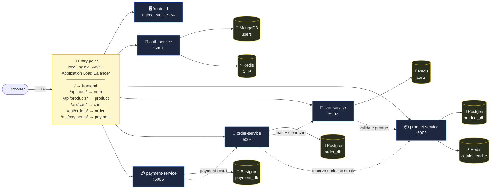

<div align="center">

# 🛒 CloudCart

### A 5-microservice e-commerce demo, built to be deployed to AWS **by hand, in the console**, one stage at a time.


</div>

---

## 🎯 What this project is for

You want to **learn AWS deployment properly** — not by running a Terraform script, but by clicking through every console screen, understanding every field, and being able to do it again alone for a real production project.

CloudCart gives you a realistic application to deploy (five independent services that call each other, three different datastores, a reverse proxy) and a **three-stage deployment path** that grows from "it runs on one EC2 box" to "CloudFront + WAF + multi-AZ":

| Stage | Nickname | What you learn | Daily cost (approx.) |
|:-----:|----------|----------------|:--------------------:|
| 🟢 **1** | **MVP** | VPC, security groups, IAM, ECR, RDS, ECS on EC2, ALB path routing, CloudWatch, SSM Session Manager | ~₹130 / day |
| 🟡 **2** | **Hardened** | Private subnets + NAT, VPC endpoints, Secrets Manager, ElastiCache, HTTPS/ACM/Route 53, auto scaling, CI/CD (GitHub Actions / Jenkins) | ~₹250 / day |
| 🔴 **3** | **Production** | CloudFront + WAF, Global Accelerator, Multi-AZ RDS, DocumentDB, backups, alarms, DR, runbooks | ~₹600+ / day |

Every stage ends with a **✅ Verify** checklist and a **🧹 Teardown** note, so you only pay for what you are actively using.

---

## 🏗️ Architecture at a glance



**Solid arrows** = client traffic through the entry point. **Dotted arrows** = service-to-service calls, protected by an internal token.

---

## 🧩 The services

| Service | Port | Datastore | Owns |
|---------|:----:|-----------|------|
| 🔐 `auth-service` | 5001 | MongoDB + Redis | Passwordless OTP login, users, roles, JWT issuing |
| 📦 `product-service` | 5002 | PostgreSQL + Redis | Catalog, stock, atomic stock reservation |
| 🛒 `cart-service` | 5003 | Redis | One cart per user (Redis hash, 7-day TTL) |
| 🧾 `order-service` | 5004 | PostgreSQL | Checkout orchestration, order history |
| 💳 `payment-service` | 5005 | PostgreSQL | Mock payment gateway + payment ledger |
| 🖥️ `frontend` | 80 | — | Static SPA served by nginx |

Why these datastores? → see [docs/02-architecture-hld.md](docs/02-architecture-hld.md#why-three-datastores).

---

## 🚀 Quick start (local)

```bash
git clone <your-repo-url> cloudcart && cd cloudcart
docker compose up -d --build        # ~3-5 min first time
open http://localhost:8080          # login as asha@cloudcart.local — the OTP is shown on screen in dev mode
```

Full walkthrough with checkpoints: **[docs/01-local-setup.md](docs/01-local-setup.md)**

---

## 📚 Documentation map

| # | Document | Read it when… |
|:-:|----------|---------------|
| 01 | [Local setup & testing](docs/01-local-setup.md) | you want it running on Docker Desktop in 10 minutes |
| 02 | [High-Level Design](docs/02-architecture-hld.md) | you want the big picture + the AWS service mapping |
| 03 | [Low-Level Design](docs/03-lld.md) | you need API contracts, schemas, sequence diagrams, env vars |
| 04 | [🟢 AWS Stage 1 — MVP](docs/04-aws-stage1-mvp.md) | first deployment, every console field explained |
| 05 | [🟡 AWS Stage 2 — Hardened](docs/05-aws-stage2-hardening.md) | private networking, secrets, HTTPS, scaling, CI/CD |
| 06 | [🔴 AWS Stage 3 — Production](docs/06-aws-stage3-production.md) | edge, security, HA, backups, go-live checklist |
| 07 | [IAM roles & policies](docs/07-iam-roles-and-policies.md) | you need to know exactly which roles to create and why |
| 08 | [DevOps checklist](docs/08-devops-checklist.md) | you are the DevOps engineer and want to know what to watch |
| 09 | [Cost ledger & teardown](docs/09-cost-and-teardown.md) | before you create anything, and before you go to sleep |
| 10 | [Troubleshooting](docs/10-troubleshooting.md) | something is red and you don't know why |
| 11 | [Task definition deep dive](docs/11-task-definition-deep-dive.md) | you are on the *Create task definition* screen and want every field explained (+ ECS Exec) |
| 12 | [Cluster, target groups, ALB & service deep dive](docs/12-ecs-cluster-service-alb-deep-dive.md) | you are creating the cluster, target groups, ALB rules or an ECS service |

> 💡 **Diagrams** are written in [Mermaid](https://mermaid.js.org). GitHub renders them automatically. In VS Code install the extension *"Markdown Preview Mermaid Support"*, then press `Ctrl+Shift+V`.

---

## 📁 Repository layout

```
cloudcart/
├── docker-compose.yml          ← full local stack (3 datastores + 5 services + nginx)
├── .env.example                ← copy to .env
├── frontend/                   ← SPA + nginx (two configs: local proxy / AWS static)
├── services/
│   ├── auth-service/           ← Node + Mongoose + ioredis (+ optional SES)
│   ├── product-service/        ← Node + pg + ioredis
│   ├── cart-service/           ← Node + ioredis
│   ├── order-service/          ← Node + pg
│   └── payment-service/        ← Node + pg
├── db/postgres/                ← SQL that creates the 3 databases + seed data
├── scripts/
│   ├── smoke-test.sh           ← end-to-end test (local or AWS)
│   └── build-and-push-ecr.sh   ← the only CLI step in Stage 1
├── .github/workflows/deploy.yml← CI/CD for Stage 2
└── docs/                       ← everything listed above
```

---

## 🔑 Demo accounts

| Email | Role | Notes |
|-------|------|-------|
| `admin@cloudcart.local` | admin | can add products, change user/order status |
| `asha@cloudcart.local` | customer | |
| `ravi@cloudcart.local` | customer | |

Any **new** email + name creates a customer account on first OTP request.
OTP is shown in the UI while `DEV_SHOW_OTP=true` (default). Use card digits **`0000`** at payment to simulate a declined card.

---

<div align="center">
<sub>Built as a hands-on AWS learning project. Delete everything when you're done — <a href="docs/09-cost-and-teardown.md">here's the order to do it in</a>.</sub>
</div>
