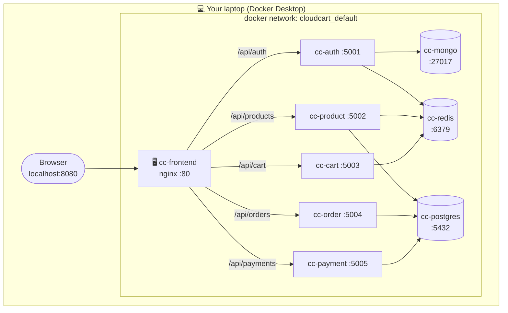

# 01 · Local setup & testing (Docker Desktop)

> ⏱️ **Time:** ~15 minutes · 💰 **Cost:** ₹0 · 🎯 **Goal:** the whole stack running on your laptop, every service verified, and you understand *what* is running and *why*.

---

## 📋 Prerequisites

| Tool | Check it | Install |
|------|----------|---------|
| Docker Desktop (with Compose v2) | `docker compose version` → `v2.x` or higher | https://www.docker.com/products/docker-desktop |
| Git | `git --version` | https://git-scm.com |
| *(optional)* `curl` + `jq` | `jq --version` | Windows: `winget install jqlang.jq` · Mac: `brew install jq` |
| 4 GB RAM free for Docker | Docker Desktop → Settings → Resources | |

> 🪟 **Windows users:** run commands in **PowerShell** or **Git Bash**. All commands below work in both unless noted.

---

## 🗺️ What you are about to start



**9 containers.** nginx is the only one you talk to directly — it forwards `/api/*` to the right service, exactly the way the AWS Application Load Balancer will later. Containers find each other by **service name** (`postgres`, `redis`, `product-service`…) because Docker Compose runs its own DNS on the network.

---

## ▶️ Step 1 — Clone and configure

```bash
git clone <your-repo-url> cloudcart
cd cloudcart
cp .env.example .env          # Windows PowerShell:  Copy-Item .env.example .env
```

`.env` holds two shared secrets. Open it and read the comments — these are the first two values you will later move into **AWS Secrets Manager**.

| Variable | Used by | Why it must match across services |
|----------|---------|-----------------------------------|
| `JWT_SECRET` | all 5 services | auth-service *signs* tokens, the others *verify* them |
| `INTERNAL_SERVICE_TOKEN` | product, cart, order, payment | proves a request came from another service, not a browser |

---

## ▶️ Step 2 — Build and start everything

```bash
docker compose up -d --build
```

What happens (first run takes 3–5 minutes):

1. 🐳 Pulls `postgres:16-alpine`, `mongo:7`, `redis:7-alpine`, `node:20-alpine`, `nginx:1.27-alpine`
2. 🔨 Builds 6 images from the Dockerfiles (5 services + frontend)
3. 🗄️ Starts the three datastores and waits for their **health checks** to pass
4. 🚀 Starts the services in dependency order (`depends_on` in the compose file)
5. 🐘 Postgres runs every file in `db/postgres/` **once** → creates `product_db`, `order_db`, `payment_db` and seeds 12 products
6. 🍃 auth-service seeds 3 users into MongoDB on first boot

> 💡 **Why `-d`?** Detached mode. Your terminal is free; use `docker compose logs -f` to watch.
> 💡 **Why `--build`?** Forces a rebuild of the images. Omit it for faster restarts when you haven't changed code.

---

## ✅ Checkpoint A — are the containers up?

```bash
docker compose ps
```

You should see **9 rows, all `running`**, and the three datastores showing `(healthy)`:

```
NAME          IMAGE                       STATUS
cc-auth       cloudcart-auth-service      Up 40 seconds (healthy)
cc-cart       cloudcart-cart-service      Up 40 seconds (healthy)
cc-frontend   cloudcart-frontend          Up 38 seconds (healthy)
cc-mongo      mongo:7                     Up 50 seconds (healthy)
cc-order      cloudcart-order-service     Up 40 seconds (healthy)
cc-payment    cloudcart-payment-service   Up 40 seconds (healthy)
cc-postgres   postgres:16-alpine          Up 50 seconds (healthy)
cc-product    cloudcart-product-service   Up 40 seconds (healthy)
cc-redis      redis:7-alpine              Up 50 seconds (healthy)
```

❌ **A service keeps restarting?** `docker compose logs <name>` — 9 times out of 10 the datastore wasn't ready yet; it will settle within 30 seconds. See [10-troubleshooting.md](10-troubleshooting.md) if not.

---

## ✅ Checkpoint B — are the services healthy?

Open **http://localhost:8080** → scroll to the footer → click **Service health**. All six cards should be 🟢.

Or from the terminal:

```bash
curl http://localhost:8080/api/products/health
# {"status":"OK","service":"product-service","database":"connected","cache":"ready",...}
```

Every service answers on **two** paths: `/health` (used by Docker and later by the ALB target group) and `/api/<prefix>/health` (reachable through nginx/ALB for the UI).

---

## ✅ Checkpoint C — the full user journey

Do this **in the browser** so you see what each service does:

| # | Action | Which service handles it | What to look for |
|:-:|--------|--------------------------|------------------|
| 1 | Login with `asha@cloudcart.local` → **Send OTP** | 🔐 auth → Redis | yellow box shows the OTP (dev mode). In the logs: `DEV MODE: OTP for asha@... is 123456` |
| 2 | Enter the OTP → **Verify** | 🔐 auth → MongoDB | you land on the shop; the token is in `localStorage` (DevTools → Application) |
| 3 | Filter by **Books**, search "data" | 📦 product → Postgres + Redis | second identical request is served from cache (`X-Cache: HIT` header in DevTools → Network) |
| 4 | **Add to cart** twice on the same item | 🛒 cart → Redis, calls product | cart pill in the header updates |
| 5 | Try to add **Ceramic Coffee Mug** | 🛒 cart | button is disabled — stock is 0 (seeded on purpose) |
| 6 | Cart → set quantity above stock | 🛒 cart | toast: *Only N left in stock* |
| 7 | **Place order** | 🧾 order → cart (read) → product (reserve) → Postgres → cart (clear) | you are taken to Payment; cart is now empty |
| 8 | Pay with card **4242** | 💳 payment → Postgres → order (callback) | toast *Payment successful*, order shows **PAID** |
| 9 | Repeat 4 → 7, pay with **0000** | 💳 payment → order → product (release) | order shows **PAYMENT FAILED**, stock is restored |
| 10 | Logout, login as `admin@cloudcart.local` → **Admin** | 🔐 auth (admin), 🧾 order (admin) | add a product, change an order to SHIPPED |

Or run it all in 5 seconds:

```bash
./scripts/smoke-test.sh           # Git Bash / Mac / Linux
```

---

## 🔍 Look under the hood

### See the data

```bash
# PostgreSQL — three separate databases on one instance
docker exec -it cc-postgres psql -U postgres -c "\l"
docker exec -it cc-postgres psql -U postgres -d order_db -c "SELECT id,status,total_amount FROM orders;"

# MongoDB — users collection
docker exec -it cc-mongo mongosh -u admin -p password --quiet --eval "db.getSiblingDB('cloudcart_auth').users.find({}, {name:1,email:1,role:1,status:1})"

# Redis — carts and OTPs
docker exec -it cc-redis redis-cli KEYS '*'
docker exec -it cc-redis redis-cli HGETALL "cart:<paste a user id>"
```

### Watch the services talk to each other

```bash
docker compose logs -f order-service cart-service product-service
```

Place an order and watch the log lines interleave: order → cart (`GET /api/cart/internal/...`) → product (`POST /api/products/internal/reserve`) → cart (`DELETE ...`). This is the chain the ALB will carry in AWS.

### Logs are JSON on purpose

```json
{"ts":"2026-10-20T12:00:00.000Z","service":"order-service","level":"info","msg":"Order created","orderId":7,"userId":"…","total":"5998.00"}
```

CloudWatch Logs Insights can query these fields directly (`filter service="order-service" and level="error"`). Services **never write log files** — stdout only — which is what Docker and ECS expect.

---

## 🛠️ Everyday commands

| I want to… | Command |
|------------|---------|
| stop everything, keep data | `docker compose down` |
| stop everything, **wipe** databases | `docker compose down -v` |
| rebuild one service after editing code | `docker compose up -d --build order-service` |
| open a shell inside a container | `docker exec -it cc-order sh` |
| see resource usage | `docker stats` |
| run the AWS-flavoured frontend image locally | `docker build -t cc-frontend-aws frontend && docker run -p 9090:80 cc-frontend-aws` (serves static only; `/api` will 404 — expected) |

---

## 🧠 What to remember for AWS

| Local thing | What it becomes in AWS | Stage |
|-------------|------------------------|:-----:|
| `docker compose up` | ECS cluster + task definitions + services | 1 |
| nginx `location /api/...` blocks | ALB listener rules | 1 |
| container names as hostnames | ALB DNS name (Stage 1) → ECS Service Connect (Stage 2) | 1→2 |
| `cc-postgres` | Amazon RDS for PostgreSQL | 1 |
| `cc-mongo` | MongoDB Atlas M0 → Amazon DocumentDB | 1→3 |
| `cc-redis` | Redis sidecar container → ElastiCache | 1→2 |
| `.env` | plain task env vars → Secrets Manager | 1→2 |
| `docker compose logs` | CloudWatch Logs | 1 |
| `docker compose ps` healthy | target group health checks | 1 |

---

### ✅ Done when

- [ ] `docker compose ps` shows 9 running containers
- [ ] Service health page is all green
- [ ] You completed an order with card 4242 (PAID) and one with 0000 (PAYMENT FAILED)
- [ ] 📌 **Commit and push your repo to GitHub** — Stage 1 starts from a clean, pushed repo.

➡️ Next: [02 · High-Level Design](02-architecture-hld.md) (10 min read) then [04 · AWS Stage 1](04-aws-stage1-mvp.md).
