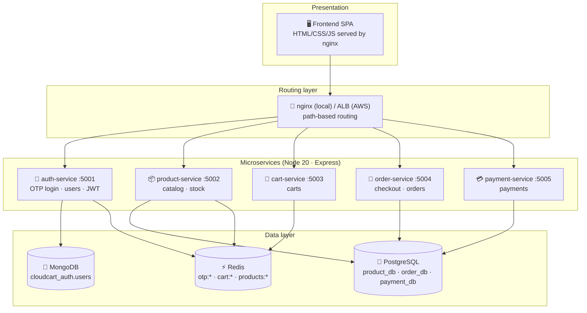
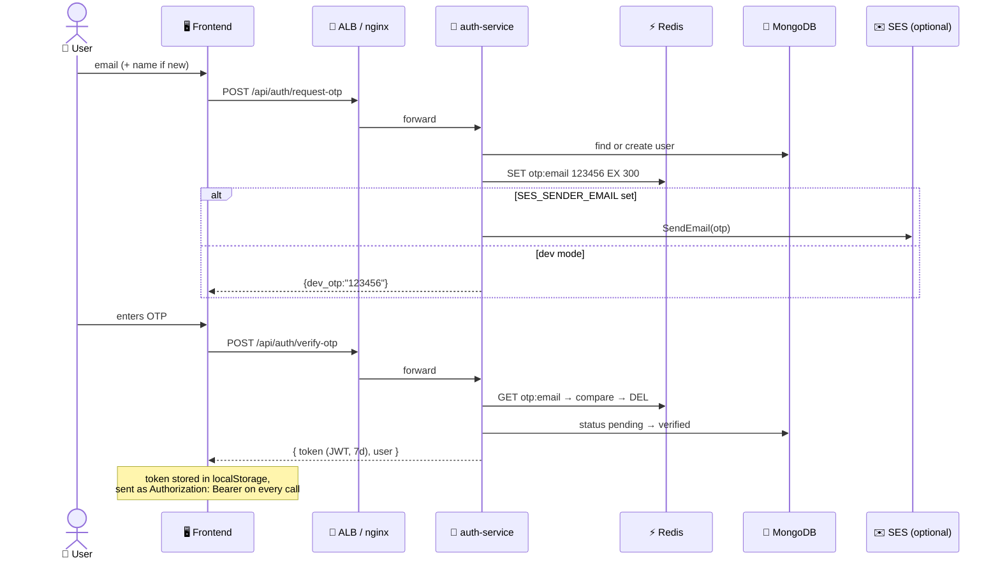
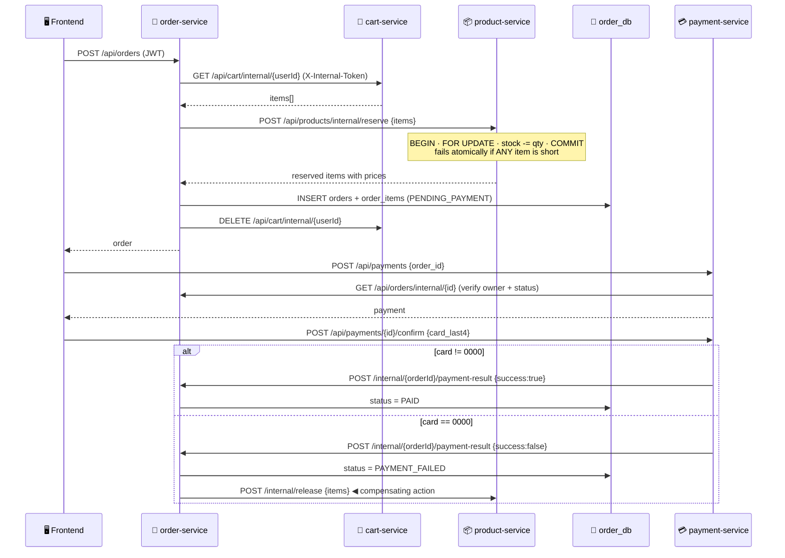
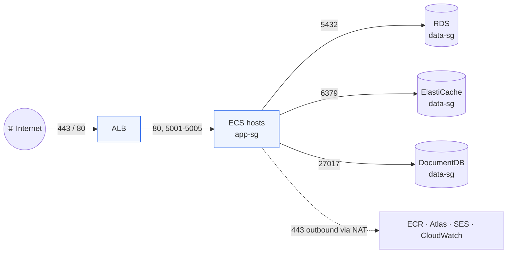
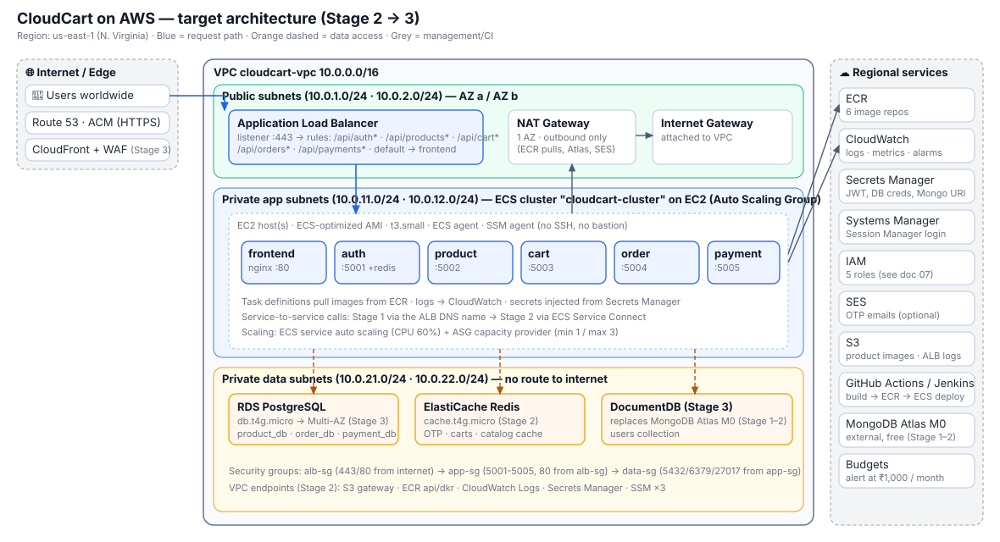

# 02 · High-Level Design (HLD)

> 🎯 **Purpose:** explain *what* CloudCart is made of, *why* it is split the way it is, and *which AWS service* each piece becomes at each stage. Read this once before Stage 1; come back to it whenever a console screen asks "why?".

---

## 1. 📐 Design principles

| Principle | What it means here | Where you'll see it in AWS |
|-----------|--------------------|----------------------------|
| **One entry point** | Browsers only ever talk to nginx (local) / the ALB (AWS). Services are never exposed to the internet. | ALB in public subnets, ECS hosts in private subnets, security-group chain |
| **Database per service** | Each service owns its data. No service reads another service's tables — it asks the owning service over HTTP. | 3 databases on one RDS instance; Redis keys namespaced per service |
| **Stateless services** | No session memory, no local files. Any instance can serve any request. JWT carries the user. | ECS can kill/restart/scale tasks freely; ALB round-robins |
| **Synchronous REST, compensating actions** | Checkout calls other services in sequence; if a later step fails, earlier steps are undone (stock released). | Visible in order-service logs; an SQS-based async version is a Stage 3 stretch goal |
| **12-factor config** | Everything environment-specific is an env var. Same image runs locally and in AWS. | Task-definition env vars → Secrets Manager |
| **Logs to stdout as JSON** | No log files inside containers. | CloudWatch Logs + Logs Insights queries |
| **Health endpoints everywhere** | `/health` on every service checks its own dependencies. | Docker health checks → ALB target-group health checks |
| **Least privilege** | Each service/host gets only the permissions it needs. | 5 IAM roles, 3 security groups (see [07](07-iam-roles-and-policies.md)) |

---

## 2. 🧱 Component view

### Service responsibilities

| Service | Public API (via ALB) | Internal API (service-to-service) | Calls out to |
|---------|----------------------|-----------------------------------|--------------|
| 🔐 **auth** | request-otp, verify-otp, me, users (admin) | — | SES (optional) |
| 📦 **product** | list, categories, detail, create/update (admin) | `reserve`, `release` stock | — |
| 🛒 **cart** | get, add, update, remove, clear | `internal/:userId` get + clear | product |
| 🧾 **order** | create (checkout), list, detail, status (admin) | `internal/:id`, `payment-result` | cart, product |
| 💳 **payment** | create, confirm, list by order | — | order |

### Why five services and not one?

Because that is the point of the exercise: in AWS, each becomes its **own ECS service** with its own task definition, target group, listener rule, log group, scaling policy and (optionally) IAM role. Doing it five times makes the pattern stick. The services are deliberately small so the AWS part stays the focus.

---

## 3. 🗄️ Why three datastores

| Datastore | Holds | Why this one |
|-----------|-------|--------------|
| 🍃 **MongoDB** | users | User profiles are document-shaped (optional address, future preferences, roles). No joins needed. Also lets you practise **DocumentDB / Atlas** in AWS. |
| 🐘 **PostgreSQL** | products, orders, order_items, payments | Money and stock need **ACID transactions** (`SELECT … FOR UPDATE`, `BEGIN/COMMIT`), constraints (`stock >= 0`) and relational reporting. Maps to **RDS**. |
| ⚡ **Redis** | OTPs (5-min TTL), carts (7-day TTL), catalog cache (60-s TTL) | Everything here is **temporary and key-based**. TTL does the clean-up. Maps to **ElastiCache**. |

> 🧠 **Rule of thumb for future projects:** transactions & reporting → relational; flexible documents → document DB; anything with a TTL, counters or a hot cache → Redis.

---

## 4. 🔁 Key flows

### 4.1 Login (passwordless OTP)

### 4.2 Checkout (the orchestration that makes it "microservices")

**What to notice:** order-service never touches `product_db`. It *asks* product-service to change stock. That is the "database per service" rule enforced in code, and it is what lets you later scale, redeploy or rewrite product-service independently.

---

## 5. 🔒 Security model

| Layer | Mechanism | Notes |
|-------|-----------|-------|
| Network | **Security-group chaining**: `alb-sg` → `app-sg` → `data-sg`. Each rule's *source* is the previous group, not an IP range. | Hosts in private subnets have no public IP (Stage 2+) |
| Transport | HTTPS at the ALB (ACM certificate), HTTP inside the VPC | Stage 2 |
| User auth | JWT (HS256, 7-day expiry) issued by auth-service, verified by every service with the shared `JWT_SECRET` | Rotating the secret logs everyone out — acceptable here |
| Authorization | `role` claim in the JWT: `customer` / `admin` | checked per route |
| Service-to-service | `X-Internal-Token` header on `/internal/*` routes; those paths are **not** exposed by ALB rules (they're only reachable inside the VPC) | Stage 2 Service Connect keeps them off the ALB entirely |
| Secrets | env vars → **Secrets Manager** referenced from task definitions | Stage 2 |
| Host access | **SSM Session Manager** — no SSH port, no key pairs, no bastion, every session logged | Stage 1 |
| Edge | CloudFront + **WAF** managed rules (SQLi, XSS, rate limit) | Stage 3 |

---

## 6. ☁️ AWS service mapping by stage

| Component | 🟢 Stage 1 — MVP | 🟡 Stage 2 — Hardened | 🔴 Stage 3 — Production |
|-----------|------------------|-----------------------|-------------------------|
| Network | VPC, 2 public + 2 private subnets, **no NAT** (hosts in public subnets) | hosts move to **private subnets**, 1 NAT gateway, **VPC endpoints** | add private *data* subnets; 2 NATs (one per AZ) |
| Entry | ALB (HTTP :80), 6 target groups, path rules | ALB **HTTPS :443** with ACM cert, HTTP→HTTPS redirect, Route 53 alias | **CloudFront + WAF** in front, optional **Global Accelerator** |
| Compute | ECS cluster on **1 × t3.small EC2** via ASG (min 1 / max 1) | ASG min 1 / max 3, **capacity provider**, ECS service auto scaling | spread across 2 AZs, min 2 hosts |
| Images | ECR, pushed from laptop | ECR, pushed by **GitHub Actions (OIDC)** or Jenkins | image scanning on push, lifecycle policy |
| PostgreSQL | **RDS** db.t4g.micro, single-AZ, 20 GB | automated backups 7 d, Performance Insights | **Multi-AZ**, deletion protection, read replica if needed |
| MongoDB | **MongoDB Atlas M0** (free, external) | same | **Amazon DocumentDB** inside the VPC |
| Redis | **sidecar container** in each task that needs it | **ElastiCache** cache.t4g.micro, shared | ElastiCache with replica (Multi-AZ) |
| Service discovery | call each other via the **ALB DNS name** | **ECS Service Connect** (`http://product-service:5002`) | same |
| Config/secrets | plain env vars in task definitions | **Secrets Manager** + SSM Parameter Store | secret rotation |
| Logs/metrics | **CloudWatch Logs** (awslogs driver), Container Insights off | Container Insights on, **alarms** (5xx, unhealthy hosts, CPU) | dashboard, SNS → email/Slack, log retention policy |
| Host access | **SSM Session Manager** | same, via SSM VPC endpoints | same |
| Email | OTP in logs (dev mode) | **SES** sandbox → verified sender | SES production access |
| Static files | served by nginx task | same | optionally S3 + CloudFront origin |
| Shared files | — | — | **EFS** mounted into tasks (only if you need it — e.g. uploads) |
| CI/CD | manual script | GitHub Actions **or** Jenkins on EC2 | blue/green via CodeDeploy (stretch) |
| Cost guard | **AWS Budgets** alert | tag-based cost allocation | Cost Anomaly Detection |

---

## 7. 📏 Non-functional targets (demo scale)

| Aspect | Target | How it's met |
|--------|--------|--------------|
| Availability | 99 % (Stage 1) → 99.9 % (Stage 3) | single host → multi-AZ hosts + Multi-AZ RDS |
| Latency | < 300 ms p95 for catalog reads | Redis cache, ALB in region close to users, CloudFront for static |
| Throughput | ~50 req/s on one t3.small | Node is async; scale out via ECS service scaling |
| Recovery | RDS point-in-time restore; stateless tasks restart automatically | ECS desired count, ALB health checks, RDS backups |
| Security | no public DB, no SSH, secrets never in git | SG chain, SSM, Secrets Manager |
| Cost | ≤ ₹110 / day in Stage 1 | smallest instance classes, no NAT, Atlas free tier, teardown discipline |

---

## 8. 📝 Naming conventions (use them everywhere)

| Thing | Pattern | Example |
|-------|---------|---------|
| Everything in AWS | `cloudcart-<what>` | `cloudcart-vpc`, `cloudcart-alb`, `cloudcart-cluster` |
| ECR repos | `cloudcart/<service>` | `cloudcart/order-service`, `cloudcart/frontend` |
| ECS task families & services | `cc-<service>` | `cc-order` |
| Target groups | `cc-tg-<service>` | `cc-tg-order` |
| Security groups | `cloudcart-<tier>-sg` | `cloudcart-app-sg` |
| IAM roles | `cloudcart-<purpose>-role` | `cloudcart-ecs-instance-role` |
| Log groups | `/ecs/cloudcart/<service>` | `/ecs/cloudcart/order` |
| Tag on **every** resource | `Project = cloudcart` | lets Cost Explorer and Tag Editor find everything for teardown |

➡️ Next: [03 · Low-Level Design](03-lld.md) for contracts and schemas, or jump to [04 · Stage 1](04-aws-stage1-mvp.md).
