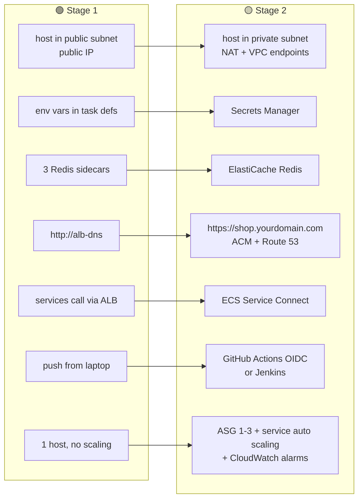

# 05 · 🟡 AWS Stage 2 — Hardened ("looks like a real deployment")

> ⏱️ **Time:** 4–5 hours · 💰 **Cost while running:** ≈ ₹250 / day · 🎯 **Goal:** no public IPs on hosts, no secrets in plain text, HTTPS on your own domain, a shared Redis, auto scaling, and every deploy done by CI/CD instead of your laptop. **Prerequisite:** Stage 1 is running and verified.

Work through the steps **in order** — each one has a ✅ checkpoint; if it fails, fix it before continuing, because later steps assume it.

---

## 🗺️ Stage 1 → Stage 2 changes



| Step | Adds | Daily cost delta |
|:----:|------|:----------------:|
| 1 | NAT gateway + VPC endpoints | +₹90 (NAT) +₹60 (5 interface endpoints) |
| 2 | ElastiCache cache.t4g.micro | +₹35 |
| 3 | Secrets Manager (4 secrets) | +₹4 |
| 4 | ACM + Route 53 hosted zone | +₹1.5 (zone) |
| 5 | Service Connect | ₹0 |
| 6 | Second EC2 host when scaled | +₹45 only while scaled |
| 7 | CloudWatch alarms + Container Insights | +₹10 |
| 8 | SES | ₹0 (sandbox) |
| 9 | GitHub Actions | ₹0 · Jenkins alternative +₹80 |

> 💡 **Skipping NAT to save money?** You can do Steps 2–9 while keeping the host in the public subnet. Only Step 1 depends on NAT. But Step 1 is the single most important production habit — do it at least once.

---

## Step 1 — Move hosts to private subnets: NAT gateway + VPC endpoints (30 min)

### 1.1 Why both NAT *and* endpoints?

A host in a private subnet has **no route to the internet**. It still needs to reach: ECR (pull images), CloudWatch Logs, SSM (Session Manager), Secrets Manager, Atlas and SES. Two ways out:

| | NAT gateway | Interface VPC endpoint |
|---|---|---|
| Reaches | anything on the internet | one AWS service, privately |
| Cost | ₹0.045/h ≈ ₹90/day + ₹0.045/GB | ₹0.01/h each ≈ ₹20/day + ₹0.01/GB |
| Use for | Atlas, SES, npm, OS updates | ECR, Logs, SSM, Secrets Manager (high-volume, security-sensitive) |

We create one NAT (for Atlas/SES) and endpoints for the AWS services, so most traffic never leaves AWS. (In Stage 3, DocumentDB replaces Atlas and the NAT is used only by SES and patches.)

### 1.2 NAT gateway

**VPC → NAT gateways → Create NAT gateway**

| Field | Value | Why |
|-------|-------|-----|
| Name | `cloudcart-nat-a` | |
| Subnet | `cloudcart-subnet-public1-us-east-1a` | NAT **lives in a public subnet** |
| Connectivity type | Public | |
| Elastic IP allocation ID | **Allocate Elastic IP** | the fixed IP all outbound traffic uses — 📒 note it; Atlas will whitelist it |

Then wire the private route tables: **Route tables → `cloudcart-rtb-private1-us-east-1a` → Routes → Edit → Add route** `0.0.0.0/0` → Target *NAT gateway* → `cloudcart-nat-a`. **Repeat for `cloudcart-rtb-private2-us-east-1b`** (same NAT; one NAT serving both AZs is the Stage 2 cost compromise — Stage 3 adds a second).

### 1.3 Interface endpoints (×5) and confirm the S3 gateway

**VPC → Endpoints → Create endpoint**, for each row:

| Name | Service name (search) | Type | Subnets | Security group | Private DNS |
|------|-----------------------|------|---------|----------------|:-----------:|
| `cc-vpce-ecr-api` | `com.amazonaws.us-east-1.ecr.api` | Interface | both **private** | `cloudcart-vpce-sg` *(create: inbound 443 from `cloudcart-app-sg`)* | ✅ |
| `cc-vpce-ecr-dkr` | `…ecr.dkr` | Interface | both private | same | ✅ |
| `cc-vpce-logs` | `…logs` | Interface | both private | same | ✅ |
| `cc-vpce-secrets` | `…secretsmanager` | Interface | both private | same | ✅ |
| `cc-vpce-ssm` | `…ssm`, `…ssmmessages`, `…ec2messages` *(three endpoints — Session Manager needs all three)* | Interface | both private | same | ✅ |
| *(exists)* | `…s3` | Gateway | private route tables | — | — |

> 🧠 **Private DNS enabled** is what makes `ecr.us-east-1.amazonaws.com` resolve to the endpoint's private IP instead of the public one — so your code and the ECS agent need no changes.

### 1.4 Move the ECS hosts

ECS → `cloudcart-cluster` → **Infrastructure** → the Auto Scaling group link → **Edit**:
- Network → Subnets: **replace** the public subnets with the two **private** subnets.
- Launch template → **Modify launch template (create new version)** → Network settings → *Auto-assign public IP*: **Disable** → Create. Back in the ASG set *Launch template version* to **Latest**.

Then **Instance refresh → Start instance refresh** (min healthy 0 %) — the old host is replaced by one in a private subnet. Tasks restart on it (2–4 min).

### 1.5 Lock Atlas down
Atlas → Network Access → delete `0.0.0.0/0` → add the **NAT Elastic IP**/32.

### ✅ Verify
- EC2 → the new instance has **no public IPv4**, subnet is `…private…`.
- Session Manager → Connect still works (through the SSM endpoints). Inside: `curl -s https://api.ipify.org` prints the **NAT EIP** (that's your outbound identity).
- ECS → all 6 services back to 1/1 running; target groups healthy; `http://<alb-dns>` works; login works (Atlas reachable).
- VPC → Endpoints: 8 endpoints *Available*.

📒 Ledger: NAT gateway + EIP, 8 endpoints, `cloudcart-vpce-sg`, new launch template version.

---

## Step 2 — ElastiCache Redis (20 min)

### 2.1 Subnet group and cluster

**ElastiCache → Subnet groups → Create**: name `cloudcart-cache-subnets`, VPC `cloudcart-vpc`, both **private** subnets.

**ElastiCache → Redis OSS caches (or Valkey) → Create**

| Field | Value | Why |
|-------|-------|-----|
| Deployment option | **Design your own cache** | *Serverless* has a minimum charge that's too high for a demo |
| Creation method | **Cluster cache** → Cluster mode **Disabled** | one primary, simple endpoint |
| Name | `cloudcart-redis` | |
| Engine | Valkey 8 (or Redis OSS 7) | Valkey is the cheaper, API-compatible fork |
| Node type | **cache.t4g.micro** | smallest |
| Number of replicas | **0** | Stage 3 adds one |
| Subnet group | `cloudcart-cache-subnets` | |
| Security group | `cloudcart-data-sg` (remove default) | already allows 6379 from app-sg |
| Encryption in transit | off for now | the services use plain `redis://`; turning this on needs `tls: {}` in ioredis — a good Stage 3 exercise |
| Backups | off | cache data is disposable |
| Tags | `Project` = `cloudcart` | |

Wait for *Available* → copy the **Primary endpoint** (`cloudcart-redis.xxxxxx.0001.aps1.cache.amazonaws.com:6379`).

### 2.2 Point the services at it
For `cc-auth`, `cc-product`, `cc-cart`: **Task definitions → family → Create new revision → JSON**: delete the `redis` container, remove `links` and `dependsOn` from the app container, set `REDIS_HOST` to the primary endpoint host (without `:6379`). Create revision. Then **Services → cc-auth → Update → revision LATEST → Update** (×3).

### ✅ Verify
- Target groups healthy; `/api/cart/health` → `"redis":"ready"`.
- Add something to the cart, then **Session Manager** → `sudo dnf install -y redis6 && redis6-cli -h <primary-endpoint> KEYS 'cart:*'` → your cart key is there, in a *shared* Redis.
- `docker ps` on the host: **6** containers now (no sidecars).

📒 Ledger: ElastiCache `cloudcart-redis` (≈ ₹35/day), cache subnet group.

---

## Step 3 — Secrets Manager (20 min)

### 3.1 Create the secrets

**Secrets Manager → Store a new secret** (×4)

| Secret name | Type | Key/value |
|-------------|------|-----------|
| `cloudcart/jwt` | Other type of secret → **Plaintext** | the JWT secret string |
| `cloudcart/internal-token` | Plaintext | the internal token string |
| `cloudcart/db-password` | Plaintext | the RDS master password |
| `cloudcart/mongodb-uri` | Plaintext | the full Atlas URI |

Leave rotation off. Tag `Project` = `cloudcart`.

> 🧠 Plaintext secrets (not key/value JSON) let ECS inject the whole value into one env var with a plain ARN — no `:key::` suffix needed.

### 3.2 Allow the execution role to read them

IAM → Roles → `cloudcart-ecs-task-execution-role` → **Add permissions → Create inline policy → JSON**:

```json
{ "Version": "2012-10-17", "Statement": [{
  "Effect": "Allow",
  "Action": ["secretsmanager:GetSecretValue"],
  "Resource": "arn:aws:secretsmanager:us-east-1:<ACCOUNT_ID>:secret:cloudcart/*"
}]}
```
Name: `cloudcart-read-secrets`.

### 3.3 Reference them from the task definitions

New revision of each family → JSON: **remove** `JWT_SECRET`, `INTERNAL_SERVICE_TOKEN`, `DB_PASSWORD`, `MONGODB_URI` from `environment` and add:

```json
"secrets": [
  { "name": "JWT_SECRET",             "valueFrom": "arn:aws:secretsmanager:us-east-1:<ACCOUNT_ID>:secret:cloudcart/jwt-AbCdEf" },
  { "name": "INTERNAL_SERVICE_TOKEN", "valueFrom": "arn:…:secret:cloudcart/internal-token-XxYyZz" },
  { "name": "DB_PASSWORD",            "valueFrom": "arn:…:secret:cloudcart/db-password-…" },
  { "name": "MONGODB_URI",            "valueFrom": "arn:…:secret:cloudcart/mongodb-uri-…" }
]
```
(only the ones each service needs — see LLD §2). Copy each ARN from the secret's detail page. Update the six services to the new revisions.

### ✅ Verify
- Services 1/1 running. Open a task → **Configuration → Environment**: the four values show as *valueFrom …* not plain text.
- Smoke test passes (JWT still validates everywhere → all services got the same secret).
- ❌ Task stuck in *PENDING → STOPPED* with `ResourceInitializationError: unable to pull secrets`? The inline policy ARN pattern or the Secrets Manager VPC endpoint is wrong.

📒 Ledger: 4 secrets (₹0.4 each/month… trivial), inline policy.

---

## Step 4 — HTTPS: ACM certificate, Route 53, HTTPS listener (30 min)

> No domain? Skip to Step 5 — nothing else depends on this. Cheapest way to get one: Route 53 → *Registered domains* → a `.click` or `.link` domain is ~$3/year.

### 4.1 Hosted zone
**Route 53 → Hosted zones → Create hosted zone**: Domain name `yourdomain.com`, Public. If the domain is registered elsewhere (GoDaddy, Namecheap…), copy the 4 **NS** values into the registrar's *custom nameservers* and wait (minutes to hours).

### 4.2 Certificate
**Certificate Manager → Request → Public certificate**: FQDN `shop.yourdomain.com` (add `*.yourdomain.com` too if you like), Validation **DNS**, RSA 2048 → Request → open it → **Create records in Route 53** → Create. Status *Issued* within ~10 min.

### 4.3 HTTPS listener
EC2 → `cloudcart-alb` → **Listeners → Add listener**: Protocol **HTTPS**, Port **443**, Default action → Forward to `cc-tg-frontend`, Security policy *recommended*, Default SSL cert **From ACM** → yours. **Add**.
Now **recreate the 5 path rules on the HTTPS:443 listener** (same table as Stage 1 Step 9.2).

### 4.4 Redirect HTTP → HTTPS — ⚠️ **not yet**
In Stage 1 the services call each other through `http://<alb-dns>`. If you redirect port 80 now, those internal calls get a 301 and checkout breaks. **Leave HTTP:80 forwarding as it is, do Step 5 (Service Connect), then come back and:**
**HTTP:80 listener → Manage rules → Default rule → Edit → Action: Redirect** to HTTPS 443, status 301, and delete the five HTTP path rules.

### 4.5 DNS record
Route 53 → hosted zone → **Create record**: name `shop`, type **A**, **Alias ✅**, route to *Alias to Application Load Balancer* → us-east-1 → `cloudcart-alb` → Create.

### ✅ Verify
- `https://shop.yourdomain.com` → 🔒 padlock, site loads. `http://…` → redirects.
- ACM cert *In use: Yes*.

📒 Ledger: hosted zone (₹0.5/day), ACM cert (free), 443 listener.

---

## Step 5 — ECS Service Connect: services find each other by name (20 min)

Replaces the "call through the ALB" hack with a private service mesh: `http://product-service:5002` just works from any task, exactly like docker-compose.

1. **ECS → cluster → Update cluster → Service Connect defaults**: namespace **Create new** `cloudcart.local` → Update.
2. For each of `cc-product`, `cc-cart`, `cc-order` (the ones that are *called*): **Service → Update → Service Connect ✅ Turn on → Client and server** → Port alias: pick the container port → **Discovery name** `product-service` / `cart-service` / `order-service`, DNS name same, port 5002/5003/5004 → Update service.
3. For `cc-cart`, `cc-order`, `cc-payment` (the ones that *call*): if not already server-enabled, **Client side only** → Update.
4. New task-definition revisions: `PRODUCT_SERVICE_URL=http://product-service:5002`, `CART_SERVICE_URL=http://cart-service:5003`, `ORDER_SERVICE_URL=http://order-service:5004`. Update services.
5. Remove the Stage 1 extra rule "HTTP from app-sg" on `cloudcart-alb-sg` — no longer needed. Add to `cloudcart-app-sg` an inbound rule: **Custom TCP 5001-5005, source `cloudcart-app-sg`** (hosts talking to each other).

> 🧠 Service Connect injects a tiny Envoy proxy sidecar into each task (you'll see `ecs-service-connect-…` in `docker ps`). It gives you retries, per-route metrics (ECS → service → *Health and metrics*) and keeps internal endpoints off the ALB entirely.

### ✅ Verify
- Checkout works over HTTPS (order → cart → product chain crossed Service Connect).
- `curl https://shop.yourdomain.com/api/products/internal/reserve` → **404** from the ALB? No — the ALB still routes `/api/products*`; the service answers 403 (no token). That's acceptable; Stage 3 adds a WAF rule to block `/internal/` paths at the edge.
- ECS → `cc-order` → **Health and metrics** → Service Connect traffic graph shows requests to `cart-service`.

---

## Step 6 — Auto scaling (20 min)

Two layers: **ECS service auto scaling** (how many *tasks*) and the **ASG capacity provider** (how many *hosts*). The capacity provider makes ECS add a host when tasks don't fit.

### 6.1 Capacity provider
ECS → cluster → **Infrastructure → Capacity providers → Create**: Auto Scaling group = the cluster's ASG, **Managed scaling ON**, Target capacity **100 %**, Managed termination protection **ON** → Create. Then **Update cluster → Default capacity provider strategy** → this provider, Base 1, Weight 1.

ASG → Edit → **Max capacity 3**, **Min 1**. (Stage 1's deploy setting *Min 0 / Max 100 %* can now go back to **100 / 200** on each service for zero-downtime deploys.)

### 6.2 Service auto scaling (do it for `cc-product` and `cc-order` first)
Service → **Update → Service auto scaling ✅** → Min tasks **1**, Max **3** → Policy: **Target tracking**, name `cpu-60`, metric **ECSServiceAverageCPUUtilization**, target **60**, scale-out cooldown 60 s, scale-in 300 s → Update.

### ✅ Verify with a load test
From your laptop: `npx autocannon -c 50 -d 90 https://shop.yourdomain.com/api/products` (or `ab -n 20000 -c 50 …`). Watch:
- ECS → cc-product → *Service auto scaling* → desired count rises to 2–3.
- EC2 → Auto Scaling groups → activity → a **second t3.small** launches when memory on host 1 is exhausted.
- After ~10 min idle it scales back in. **Confirm the ASG is back to 1 instance** before leaving for the night.

📒 Ledger: capacity provider, scaling policies. Extra hosts cost ₹45/day **each** while they exist.

---

## Step 7 — Observability: Container Insights, alarms, dashboard (20 min)

1. ECS → cluster → **Update cluster → Monitoring → Container Insights ON** (per-task CPU/memory in CloudWatch).
2. **CloudWatch → Alarms → Create alarm** (×4):

| Alarm name | Metric | Condition | Action |
|------------|--------|-----------|--------|
| `cc-alb-5xx` | ApplicationELB → per AppELB → `HTTPCode_ELB_5XX_Count` | Sum ≥ 10 in 5 min | SNS topic `cloudcart-alerts` (create, subscribe your email, **confirm the email**) |
| `cc-unhealthy-hosts` | ApplicationELB → per TargetGroup → `UnHealthyHostCount` for `cc-tg-order` | ≥ 1 for 2 periods of 1 min | same |
| `cc-rds-cpu` | RDS → per DB → `CPUUtilization` | ≥ 80 % for 10 min | same |
| `cc-ecs-memory` | ECS → ClusterName → `MemoryReservation` | ≥ 90 % for 5 min | same |

3. **CloudWatch → Dashboards → Create** `cloudcart`: add ALB RequestCount & TargetResponseTime, per-service CPU (Container Insights), RDS connections, ElastiCache CurrConnections.

### ✅ Verify
Stop the `cc-order` service (desired 0) → within 2 min you get the `cc-unhealthy-hosts` email. Set desired back to 1. Alarm returns to OK.

📒 Ledger: SNS topic + subscription, 4 alarms, dashboard, Container Insights (small per-metric cost).

---

## Step 8 — Real OTP emails with SES (15 min)

1. **SES → Identities → Create identity → Email address** → your address → verify via the mail you receive. (Sandbox: you can only send **to** verified addresses — verify the demo recipient too. Production access needs a support request; not needed here.)
2. **IAM → Roles → Create role** → Elastic Container Service Task → inline policy `ses:SendEmail`, `ses:SendRawEmail` on `*` → name `cloudcart-auth-task-role`.
3. `cc-auth` new revision: add `"taskRoleArn": "arn:aws:iam::<ACCOUNT_ID>:role/cloudcart-auth-task-role"`, env `SES_SENDER_EMAIL=<verified address>`, `DEV_SHOW_OTP=false`. Update service.

### ✅ Verify
Login with the verified recipient email → the OTP arrives by email and is **not** shown on screen. Logs show `OTP emailed via SES`.

> 🧠 This is the first **task role** — the app code itself calling an AWS API. Compare with the execution role, which only the ECS agent uses.

---

## Step 9 — CI/CD (45 min)

Pick one. GitHub Actions is free and keyless; Jenkins teaches you the self-hosted way (and you mentioned both).

### Option A — GitHub Actions with OIDC (recommended)

1. **IAM → Identity providers → Add provider**: OpenID Connect, URL `https://token.actions.githubusercontent.com`, audience `sts.amazonaws.com`.
2. **IAM → Roles → Create role → Web identity** → the provider above, audience `sts.amazonaws.com`, GitHub organization = your username, repository = `cloudcart` → permissions: `AmazonEC2ContainerRegistryPowerUser` + inline `ecs:UpdateService`, `ecs:DescribeServices` on your cluster's services → name `cloudcart-github-actions-role`.
3. GitHub repo → **Settings → Secrets and variables → Actions → Variables**: `AWS_REGION=us-east-1`, `AWS_ACCOUNT_ID`, `AWS_ROLE_ARN`, `ECS_CLUSTER=cloudcart-cluster`.
4. Push to `main`. `.github/workflows/deploy.yml` builds 6 images, pushes `:sha` and `:latest`, then `update-service --force-new-deployment` ×6.

### Option B — Jenkins on EC2

| Item | Value |
|------|-------|
| Instance | t3.medium (Jenkins + Docker builds need ~4 GB), Amazon Linux 2023, **public subnet**, SG `cloudcart-jenkins-sg` (8080 from *My IP*, nothing else; SSM for shell) |
| IAM instance role | `cloudcart-jenkins-role`: `AmazonEC2ContainerRegistryPowerUser`, `AmazonSSMManagedInstanceCore`, inline `ecs:UpdateService` |
| Install | `sudo dnf install -y java-17-amazon-corretto docker git && sudo systemctl enable --now docker && sudo usermod -aG docker jenkins` + Jenkins repo per jenkins.io |
| Pipeline | *Pipeline from SCM* → your repo → `Jenkinsfile` (included in the repo root; mirrors the GitHub workflow) |

### ✅ Verify
Change the shop title in `frontend/index.html`, commit, push → pipeline green → within 3 min the new title is live at `https://shop.yourdomain.com`. ECS → cc-frontend → *Deployments* shows a new revision rolled out with **zero downtime** (two hosts, 100/200 %).

📒 Ledger: OIDC provider, `cloudcart-github-actions-role` *(or Jenkins EC2 ≈ ₹80/day + role + SG)*.

---

## Step 10 — Housekeeping that production teams do

| Item | Where | Setting |
|------|-------|---------|
| ECR lifecycle policy | each repo → Lifecycle policy | keep last **10** images (untagged expire after 1 day) |
| ALB access logs | ALB → Attributes → Access logs | to S3 bucket `cloudcart-alb-logs-<account>` with 30-day lifecycle rule |
| RDS backups | RDS → Modify | retention **7 days**, backup window at night IST |
| Log retention | all `/ecs/cloudcart/*` | 30 days |
| Deletion protection | ALB attributes, RDS | **on** (remember to turn **off** before teardown) |
| Cost allocation tag | Billing → Cost allocation tags | activate `Project` → Cost Explorer can filter by `cloudcart` |

---

## ✅ Stage 2 done when

- [ ] Hosts have no public IP; Session Manager still works
- [ ] `https://shop.yourdomain.com` with padlock; HTTP redirects
- [ ] Task definitions contain no plaintext secrets
- [ ] `docker ps` shows no Redis sidecars; ElastiCache has your cart keys
- [ ] Load test scaled tasks and hosts out **and back in**
- [ ] You received an alarm email
- [ ] A `git push` deployed a change with zero downtime
- [ ] 📌 **Commit and push** (workflow file, any task-def JSON changes with secrets stripped)

➡️ Next: [06 · 🔴 Stage 3 — Production](06-aws-stage3-production.md)
