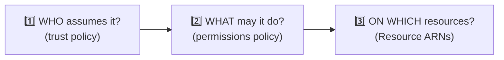
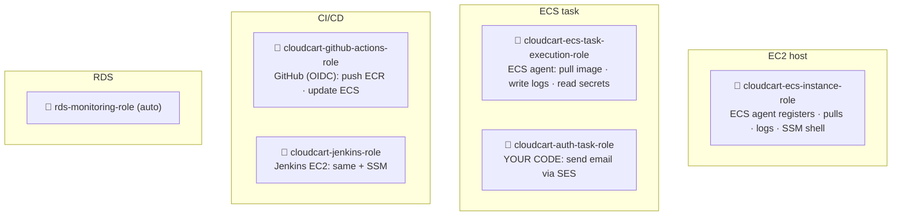

# 07 · IAM roles & policies

> 🎯 **Purpose:** the complete list of identities CloudCart needs, who assumes each one, what it may do, and why. IAM is where most "it worked yesterday" problems come from, so this doc is written to be re-read.

---

## 🧠 The three questions for every IAM role



- **Trust policy** = *who can wear this hat*: an AWS service (`ec2.amazonaws.com`, `ecs-tasks.amazonaws.com`), a federated identity (GitHub OIDC), or another account.
- **Permissions policy** = *what the hat allows*: AWS-managed (`AmazonECSTaskExecutionRolePolicy`) or inline JSON you write.
- **Resource** = narrow it: `arn:aws:secretsmanager:…:secret:cloudcart/*`, not `*`.

> A **user** (with access keys) is for humans and laptops. A **role** is for machines and services. Never put access keys inside an EC2 instance or a container — give it a role.

---

## 🗂️ The roles at a glance



| # | Role name | Assumed by (trust) | Stage | Managed policies | Inline / extra |
|:-:|-----------|--------------------|:-----:|------------------|----------------|
| 1 | `cloudcart-ecs-instance-role` | `ec2.amazonaws.com` | 1 | `AmazonEC2ContainerServiceforEC2Role`, `AmazonSSMManagedInstanceCore` | — |
| 2 | `cloudcart-ecs-task-execution-role` | `ecs-tasks.amazonaws.com` | 1 (+2) | `AmazonECSTaskExecutionRolePolicy` | `cloudcart-read-secrets` (Stage 2) |
| 3 | `cloudcart-auth-task-role` | `ecs-tasks.amazonaws.com` | 2 | — | `ses:SendEmail`, `ses:SendRawEmail` |
| 4 | `cloudcart-github-actions-role` | GitHub OIDC provider | 2 | `AmazonEC2ContainerRegistryPowerUser` | `ecs:UpdateService`, `ecs:DescribeServices` |
| 5 | `cloudcart-jenkins-role` *(alt. to 4)* | `ec2.amazonaws.com` | 2 | `AmazonEC2ContainerRegistryPowerUser`, `AmazonSSMManagedInstanceCore` | `ecs:UpdateService` |
| 6 | `AWSServiceRoleForECS` *(service-linked, auto-created)* | ECS | 1 | — | lets ECS register targets in your ALB, manage ENIs |
| 7 | `AWSServiceRoleForAutoScaling` *(auto)* | ASG | 1 | — | |
| — | *your IAM user* (console + CLI) | you | 0 | `AdministratorAccess` for a learning account | MFA on! |

---

## 1️⃣ `cloudcart-ecs-instance-role` — the EC2 host's identity

**Why:** the ECS agent running on the host must call `ecs:RegisterContainerInstance`, pull from ECR (`ecr:GetAuthorizationToken`, `ecr:BatchGetImage`), and push container logs. SSM agent must call `ssm:UpdateInstanceInformation` and the `ssmmessages:*` channel to give you a shell.

**Attach to:** the ASG's launch template (*IAM instance profile*). The cluster wizard does this when you pick the role.

**Trust policy** (what the console writes for "AWS service → EC2"):
```json
{ "Version": "2012-10-17", "Statement": [{ "Effect": "Allow",
  "Principal": { "Service": "ec2.amazonaws.com" }, "Action": "sts:AssumeRole" }] }
```

**Checks:** EC2 → instance → *IAM role* column. If empty, the host never appears in the cluster. If `AmazonSSMManagedInstanceCore` is missing, Session Manager says *not connected*.

---

## 2️⃣ `cloudcart-ecs-task-execution-role` — "start my container"

**Why:** when ECS launches a task it needs to (a) pull the image from ECR, (b) create the CloudWatch log stream, (c) in Stage 2, fetch Secrets Manager values to inject as env vars. The *agent* does this on your behalf, before your code runs.

**Referenced in:** every task definition → `executionRoleArn`.

**Stage 2 inline policy `cloudcart-read-secrets`:**
```json
{ "Version": "2012-10-17", "Statement": [{
  "Effect": "Allow",
  "Action": ["secretsmanager:GetSecretValue"],
  "Resource": "arn:aws:secretsmanager:us-east-1:<ACCOUNT_ID>:secret:cloudcart/*"
}]}
```
If you used a customer-managed KMS key for the secrets, add `kms:Decrypt` on that key too.

**Symptom when wrong:** task STOPPED with `CannotPullContainerError` (ECR) or `ResourceInitializationError: unable to pull secrets`.

---

## 3️⃣ `cloudcart-auth-task-role` — "my code calls AWS"

**Why:** only `auth-service` calls an AWS API (SES). The SDK inside the container automatically picks up the task role's temporary credentials from the ECS metadata endpoint — no keys in env vars.

**Referenced in:** `cc-auth` task definition → `taskRoleArn`.

**Inline policy:**
```json
{ "Version": "2012-10-17", "Statement": [{
  "Effect": "Allow",
  "Action": ["ses:SendEmail", "ses:SendRawEmail"],
  "Resource": "*",
  "Condition": { "StringEquals": { "ses:FromAddress": "noreply@yourdomain.com" } }
}]}
```
The `Condition` pins the sender address — a compromised container can't spam from other identities.

> Future task roles: if `product-service` ever uploads images to S3 → `cloudcart-product-task-role` with `s3:PutObject` on `arn:aws:s3:::cloudcart-images/*`. **One task role per service, named after it.** Services that call no AWS API get none.

---

## 4️⃣ `cloudcart-github-actions-role` — keyless CI/CD

**Why OIDC:** GitHub gets a short-lived token per workflow run and exchanges it for AWS credentials. No access keys to store, leak or rotate.

**Trust policy** (restricts to *your* repo and `main` branch):
```json
{ "Version": "2012-10-17", "Statement": [{
  "Effect": "Allow",
  "Principal": { "Federated": "arn:aws:iam::<ACCOUNT_ID>:oidc-provider/token.actions.githubusercontent.com" },
  "Action": "sts:AssumeRoleWithWebIdentity",
  "Condition": {
    "StringEquals": { "token.actions.githubusercontent.com:aud": "sts.amazonaws.com" },
    "StringLike":   { "token.actions.githubusercontent.com:sub": "repo:<github-user>/cloudcart:ref:refs/heads/main" }
  }
}]}
```

**Inline policy `cloudcart-deploy`:**
```json
{ "Version": "2012-10-17", "Statement": [
  { "Effect": "Allow", "Action": ["ecs:UpdateService", "ecs:DescribeServices"],
    "Resource": "arn:aws:ecs:us-east-1:<ACCOUNT_ID>:service/cloudcart-cluster/*" },
  { "Effect": "Allow", "Action": "ecs:DescribeTaskDefinition", "Resource": "*" }
]}
```
plus managed `AmazonEC2ContainerRegistryPowerUser` (push/pull). If the workflow later *registers new task-definition revisions* (instead of `--force-new-deployment`), add `ecs:RegisterTaskDefinition` and `iam:PassRole` on roles 2 and 3.

---

## 5️⃣ `cloudcart-jenkins-role` — if you choose Jenkins

Same permissions as #4, but trust = `ec2.amazonaws.com` and attached as the **instance profile** of the Jenkins EC2. Add `AmazonSSMManagedInstanceCore` so you never open port 22.

---

## 🧰 Other identities and permissions you'll meet

| Thing | What it is | Action |
|-------|------------|--------|
| **Service-linked roles** (`AWSServiceRoleForECS`, `…AutoScaling`, `…ElastiCache`, `…RDS`) | roles AWS creates for its own services the first time you use them | leave them; they're free and harmless |
| **ECR repository policy** | resource-based policy on a repo | not needed inside one account |
| **Secrets Manager resource policy** | who can read a secret, from the secret's side | not needed; IAM role side is enough |
| **S3 bucket policy** for ALB access logs | allows the ELB service to write | the ALB console offers to create it |
| **KMS key policy** | if you use a customer-managed key for RDS/secrets | add roles 2 (decrypt) and the RDS service |
| **VPC endpoint policy** | what can pass through an endpoint | default *full access* is fine in one account |
| **Permission boundaries / SCPs** | org-level guardrails | n/a for a personal account |

---

## 🔐 Your own access (Step 0 hygiene)

1. **Never use the root user** day-to-day. Create an IAM user `akshansh-admin` (or use IAM Identity Center) with `AdministratorAccess`, enable **MFA**, and log in with that.
2. The access key used by `scripts/build-and-push-ecr.sh` should belong to that user, stored only in `~/.aws/credentials`. Rotate it after the project (IAM → user → Security credentials → Deactivate).
3. For a real team: one role per *job* (`cloudcart-deployer`, `cloudcart-readonly`), humans assume roles via Identity Center, no long-lived keys anywhere.

---

## 🧪 Verify permissions without guessing

| Question | Where to look |
|----------|---------------|
| "Which role is this task running as?" | ECS → task → *Configuration* → Task role / Task execution role |
| "Why was my API call denied?" | **CloudTrail → Event history** → filter *Event name* (e.g. `GetSecretValue`) → error code `AccessDenied` shows the exact ARN and action |
| "Can this role do X?" | IAM → role → **Simulate** (IAM Policy Simulator) |
| "What has this role actually used?" | IAM → role → **Access Advisor** tab — prune unused permissions |
| "Is anything public?" | IAM → **Access Analyzer** |

---

## 🧹 Teardown note

Roles cost nothing, but delete the ones you created (1–5) and the OIDC provider for tidiness. Service-linked roles can stay (they're account-wide, not project-specific).
