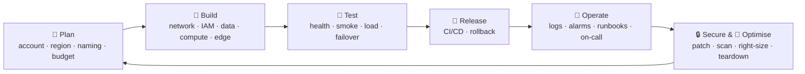

# 08 · The DevOps checklist — what to take care of, and when

> 🎯 **Purpose:** you asked *"think like I'm a new DevOps — what should I take care of?"* This is that list, organised the way the job is actually organised: **before you build, while you build, before go-live, every day after.**

---

## 🧭 The DevOps lifecycle for a project like CloudCart



---

## 1. Before you create anything (Plan)

- [ ] **Account hygiene** — root user locked with MFA, an admin IAM user for daily work, billing alerts on, **Budget** created ([Stage 1 Step 0](04-aws-stage1-mvp.md#step-0--account-preparation-10-min)).
- [ ] **Region decided** and written at the top of your notes. Everything goes there (except CloudFront certs → us-east-1).
- [ ] **Naming convention** agreed ([HLD §8](02-architecture-hld.md#8--naming-conventions-use-them-everywhere)) and a **tag** (`Project=cloudcart`) that you put on *every* resource.
- [ ] **Resource ledger** open ([09](09-cost-and-teardown.md)) — a DevOps who can't list what they created can't delete it or explain the bill.
- [ ] **Architecture diagram** drawn before clicking ([HLD §6](02-architecture-hld.md#6-️-aws-service-mapping-by-stage)). Every box = something you'll create; every arrow = a security-group rule.
- [ ] **Secrets plan** — which values are secret (JWT, DB password, internal token, Mongo URI), where they live (Secrets Manager), who may read them (execution role only).
- [ ] **Cost estimate** per stage, and a *pause* plan (what to scale to zero overnight).

## 2. While building (Build)

### Network
- [ ] Public subnets hold only things that *must* face the internet: ALB, NAT, (Stage 1 only) the host.
- [ ] Private subnets for compute, isolated subnets (no NAT route) for data.
- [ ] Security-group **chain**, sources are SG ids not CIDRs; no `0.0.0.0/0` inbound anywhere except the ALB (and later only the CloudFront prefix list).
- [ ] No SSH (port 22) rules. Session Manager instead; every session is logged.
- [ ] VPC endpoints for ECR/Logs/SSM/Secrets so private traffic stays private (and NAT data charges drop).

### Identity
- [ ] Roles, not keys, for every machine. One task role per service that calls AWS; none for the rest.
- [ ] Least privilege with resource ARNs (`secret:cloudcart/*`, not `*`).
- [ ] CI/CD via OIDC, scoped to one repo and branch.

### Data
- [ ] `Public access = No` on every database. Verify in the console *after* creation, not just in the form.
- [ ] Encryption at rest on (default), TLS in transit (RDS forces it; `DB_SSL=true`).
- [ ] Automated backups on with a retention you can defend; **restore drill done once**.
- [ ] Storage autoscaling off for demos, on with a ceiling for prod.
- [ ] Deletion protection on for prod (and remembered during teardown).

### Compute
- [ ] Every container has a `/health` endpoint that checks its dependencies; Docker, ECS and ALB all use it.
- [ ] Containers run as non-root, no writable files except `/tmp`, logs to stdout.
- [ ] CPU/memory **reservations** set from measurement (Container Insights), not guesses.
- [ ] Deployment % (100/200) only when there is room for 2× tasks; otherwise 0/100 and accept blips.
- [ ] Host **patching**: ECS-optimized AMI updated by rotating the launch template version + instance refresh, monthly.

### Delivery
- [ ] Images tagged with the git SHA; `latest` only as a convenience pointer.
- [ ] ECR scanning on; fail the pipeline on *critical* CVEs once you're past the demo.
- [ ] Rollback = redeploy previous task-def revision. **Practised once.**
- [ ] The pipeline is the *only* way images reach prod (remove laptop push rights after Stage 2).

## 3. Before go-live (Test)

| Test | How | Pass criteria |
|------|-----|---------------|
| Smoke | `scripts/smoke-test.sh https://…` | all steps green |
| Health | all target groups healthy; `/health` 200 on 6 services | |
| Security | direct ALB → 403; SQLi → 403; `/internal/` → 403/404; `nmap` the host public IP (should be none) | |
| Load | `autocannon -c 50 -d 120` on `/api/products` and on checkout | p95 < 500 ms, no 5xx, scales out *and in* |
| Failover | terminate a host; reboot RDS with failover; stop ElastiCache primary | site stays up / recovers < 60 s |
| Restore | RDS point-in-time restore to a new instance | data present |
| Alarm | break something on purpose | email arrives within 2 min |
| Cost | Cost Explorer filtered by tag after 24 h | matches estimate ± 20 % |

## 4. Every day after (Operate)

- [ ] **Morning glance**: dashboard (5xx, latency, unhealthy hosts, RDS CPU/connections, ASG size), overnight alarms, Cost Explorer *yesterday*.
- [ ] **Logs**: one saved Logs Insights query for errors across services; look at it once a day.
- [ ] **Capacity**: ASG back at baseline? Any task restarting in a loop (`docker ps` restarts count / ECS events)?
- [ ] **Certificates**: ACM auto-renews DNS-validated certs — confirm status *Issued*, no *Pending validation*.
- [ ] **Patches**: base image bumps (node, nginx, alpine) → rebuild via CI monthly; AMI rotation monthly.
- [ ] **Backups**: recovery points exist (RDS, DocumentDB, AWS Backup vault).
- [ ] **Access review** monthly: IAM Access Advisor on each role; remove unused permissions and users.
- [ ] **Runbooks** kept next to the code (`docs/runbooks/`) and updated after every incident.

## 5. Runbook template (copy for each scenario)

```markdown
# Runbook: <symptom>   (e.g. "Site returns 502")
**Severity:** P1 (users blocked) · **Owner:** <name> · **Last tested:** <date>

## Detect
- Alarm `cc-alb-5xx` / `cc-unhealthy-hosts` fired, or user report.

## Triage (5 min)
1. EC2 → Target groups → which TG is unhealthy?
2. ECS → cluster → that service → Events tab → last 10 events.
3. Task → Logs → last 100 lines.

## Likely causes → fix
| Symptom in logs | Cause | Fix |
|---|---|---|
| `ECONNREFUSED 5432` | RDS down / SG changed | RDS status; data-sg inbound from app-sg |
| `CannotPullContainerError` | ECR/NAT/endpoint | VPC endpoints, instance role |
| OOMKilled / exit 137 | memory hard limit too low | raise `memory`, redeploy |
| healthy in ECS, unhealthy in TG | wrong health path/port | TG health check `/health`, traffic port |

## Rollback
ECS → service → Update → previous task-definition revision → Deploy (≈ 2 min).

## Communicate
Status to <channel>; post-incident note within 24 h: timeline, root cause, action items.
```

## 6. Habits that separate a good DevOps from a busy one

| Habit | Why |
|-------|-----|
| **Change one thing, verify, then the next** | the stage docs are built this way on purpose — a failed step with five simultaneous changes is undebuggable |
| **Write the ledger as you go** | the teardown list and the cost explanation write themselves |
| **Everything has a health check and an alarm** | if you can't tell it's broken, it's not operated |
| **Prefer managed** (RDS over Postgres on EC2, ECS over hand-run Docker) | you're paid to run the product, not the database |
| **Tag, then automate** | manual console first (to learn), then Terraform/CDK for the second environment — with the console knowledge you now have, the IaC will make sense |
| **Tear down what you don't use tonight** | the bill, and the discipline, both matter |

➡️ [09 · Cost & teardown](09-cost-and-teardown.md)
