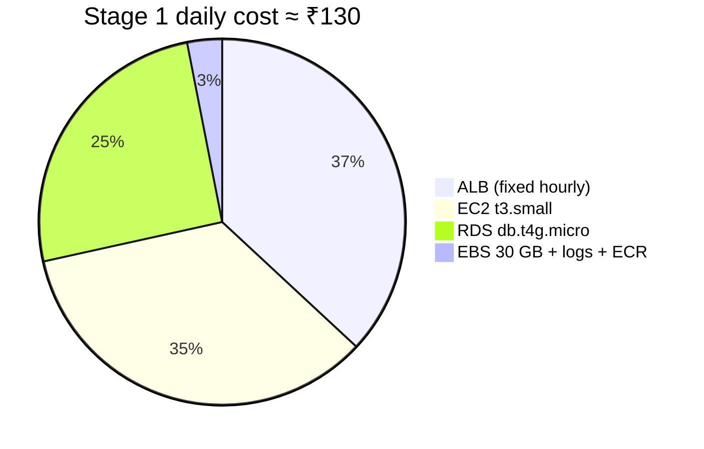
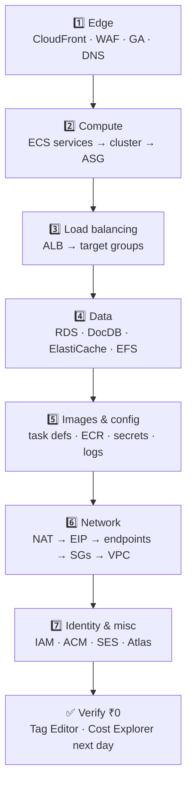

# 09 · Cost ledger & teardown

> 🎯 **Purpose:** (1) know what each stage costs *before* you build it, (2) keep a ledger of every resource you create, (3) delete everything in the right order so the bill goes to **₹0**.

Prices are **approximate us-east-1 on-demand**, converted at ₹84/$, rounded. Check the AWS pricing page for exact numbers; the *ratios* are what matter.

---

## 💸 1. What costs money (and what doesn't)

| Resource | Unit price | Stage 1 | Stage 2 | Stage 3 | Bills while idle? |
|----------|-----------|:-------:|:-------:|:-------:|:-----------------:|
| ALB | $0.0239/h + LCU | ₹48/day | ₹48 | ₹48 | ✅ **yes** |
| EC2 t3.small (ECS host) | $0.0224/h | ₹45 | ₹45–135 | ₹90–180 | ✅ yes |
| EBS gp3 30 GB per host | $0.08/GB-mo | ₹7 | ₹7–20 | ₹14 | ✅ yes |
| RDS db.t4g.micro | $0.016/h | ₹33 | ₹33 | ₹66 (Multi-AZ) | ✅ yes (can *stop* 7 days) |
| RDS storage 20 GB gp3 | $0.115/GB-mo | ₹6 | ₹6 | ₹6 | ✅ yes |
| NAT gateway | $0.045/h + $0.045/GB | — | ₹90 | ₹180 (×2) | ✅ **yes, even with no traffic** |
| Interface VPC endpoints (×7) | $0.01/h each | — | ₹140 | ₹140 | ✅ yes |
| ElastiCache cache.t4g.micro | $0.016/h | — | ₹33 | ₹66 (replica) | ✅ yes |
| DocumentDB db.t3.medium | $0.078/h | — | — | ₹157 | ✅ yes |
| Secrets Manager | $0.40/secret-mo | — | ₹4 | ₹4 | ✅ |
| CloudWatch Logs | $0.50/GB ingested | ~₹1 | ~₹2 | ~₹5 | ❌ only with traffic |
| Container Insights | per metric | — | ₹10 | ₹15 | ✅ |
| ECR storage | $0.10/GB-mo | <₹1 | <₹1 | <₹1 | ✅ tiny |
| Route 53 hosted zone | $0.50/mo | — | ₹1.5 | ₹1.5 | ✅ |
| ACM certificate | free | — | 0 | 0 | — |
| CloudFront | $0.085/GB + requests | — | — | ₹10+ | ❌ with traffic |
| WAF web ACL | $5/mo + $1/rule-mo | — | — | ₹25 | ✅ |
| Global Accelerator | $0.025/h + data | — | — | ₹50 | ✅ |
| EFS | $0.30/GB-mo | — | — | ~0 | per GB |
| MongoDB Atlas M0 | free | 0 | 0 | — | — |
| SES | $0.10/1000 mails | — | ~0 | ~0 | ❌ |
| GitHub Actions | free (public repo) / 2000 min | — | 0 | 0 | — |
| Jenkins t3.medium (optional) | $0.0448/h | — | ₹90 | ₹90 | ✅ |
| **Total ≈** | | **₹130/day** | **≈ ₹250/day** (no Jenkins) | **≈ ₹600+/day** | |

> 🧠 **Three lessons hiding in this table**
> 1. The **ALB and NAT bill per hour whether or not anyone uses them** — they are the first things to delete when pausing.
> 2. **Interface endpoints are not free**: 7 of them ≈ ₹140/day, more than the NAT they're reducing. In Stage 2 you can do just ECR (2) + Logs + SSM (3) and skip Secrets Manager's endpoint (traffic is tiny via NAT). Decide with numbers.
> 3. **Free tier** (12 months for accounts created before mid-2025; a 6-month credit model for newer accounts) can zero out EC2 t3.micro, RDS t4g.micro and 750 ALB-hours. Check **Billing → Free tier** to see what *your* account gets.

### Cost-saving switches for a demo

| Switch | Saves | Trade-off |
|--------|-------|-----------|
| Stop RDS (Actions → Stop temporarily) overnight | ₹33/day | restarts automatically after 7 days |
| ASG desired = 0 overnight | ₹45/day per host | tasks stop; ALB returns 503 |
| Delete the ALB between demo days | ₹48/day | re-create + 5 listener rules (10 min) |
| Skip NAT, keep host public (Stage 1 style) | ₹90/day | less production-like |
| Use t3.micro + fewer services running | ₹22/day | only 3–4 tasks fit |
| Skip Container Insights | ₹10/day | fewer metrics |

---

## 📒 2. Resource ledger (fill in as you go)

Copy this table into `docs/LEDGER.md` (git-ignored if you note secrets there — don't) or a notebook. One row per resource. **The *Delete order* column is the teardown sequence.**

| Delete order | Service | Resource name / id | Created in | Daily cost | Notes (endpoint, EIP, etc.) | ✅ Deleted |
|:---:|---|---|:---:|:---:|---|:---:|
| 1 | CloudFront | distribution `dxxxxxxxx` | S3 | | disable first, wait *Deployed*, then delete | ☐ |
| 2 | WAF | web ACL `CreatedByCloudFront-…` | S3 | | | ☐ |
| 3 | Global Accelerator | `cloudcart-ga` | S3 | | disable → delete | ☐ |
| 4 | Route 53 | records in zone `yourdomain.com` | S2 | | zone itself only if no longer needed | ☐ |
| 5 | ECS | services ×6 (`cc-*`) | S1 | | desired 0 → delete | ☐ |
| 6 | ECS | capacity provider | S2 | | | ☐ |
| 7 | ECS | cluster `cloudcart-cluster` | S1 | | deleting cluster deletes its ASG + launch template (console wizard ones) | ☐ |
| 8 | EC2 | Auto Scaling group / launch template (if still there) | S1 | ₹45 | confirm 0 instances | ☐ |
| 9 | EC2 | Jenkins instance (if any) | S2 | ₹90 | | ☐ |
| 10 | ELB | `cloudcart-alb` | S1 | ₹48 | turn off deletion protection first | ☐ |
| 11 | ELB | target groups ×6 | S1 | | | ☐ |
| 12 | RDS | `cloudcart-postgres` | S1 | ₹33 | deletion protection off; **skip final snapshot** for a demo | ☐ |
| 13 | RDS | subnet group `cloudcart-db-subnets` | S1 | | after instance is gone | ☐ |
| 14 | DocumentDB | `cloudcart-docdb` + instance + subnet group | S3 | ₹157 | | ☐ |
| 15 | ElastiCache | `cloudcart-redis` + subnet group | S2 | ₹33 | | ☐ |
| 16 | EFS | `cloudcart-efs` (mount targets first) | S3 | | | ☐ |
| 17 | ECS | task definitions ×6 → **deregister** all revisions, then delete | S1 | | | ☐ |
| 18 | ECR | repos ×6 (delete *with images*) | S1 | | | ☐ |
| 19 | Secrets Manager | secrets ×4 | S2 | | *schedule deletion* (min 7 days) or force-delete via CLI | ☐ |
| 20 | CloudWatch | log groups ×6, alarms ×4, dashboard | S1/S2 | | | ☐ |
| 21 | SNS | topic `cloudcart-alerts` | S2 | | | ☐ |
| 22 | VPC | **NAT gateways** ×1–2 | S2 | ₹90 each | wait *Deleted* (≈1 min) | ☐ |
| 23 | VPC | **Elastic IPs** ×1–2 → *Release* | S2 | ₹3/day if unattached! | | ☐ |
| 24 | VPC | interface endpoints ×7 | S2 | ₹140 | | ☐ |
| 25 | VPC | security groups: data → app → alb → vpce (reverse of creation) | S1 | | VPC delete does this too | ☐ |
| 26 | VPC | `cloudcart-vpc` (deletes subnets, route tables, IGW, S3 endpoint) | S1 | | fails if anything above remains — the error names it | ☐ |
| 27 | IAM | roles ×5, OIDC provider, inline policies | S1/S2 | | | ☐ |
| 28 | ACM | certificate (us-east-1, shared by ALB and CloudFront) | S2/S3 | | after ALB/CloudFront gone | ☐ |
| 29 | SES | identities | S2 | | | ☐ |
| 30 | Atlas | cluster `cloudcart` | S1 | | outside AWS | ☐ |
| 31 | Budgets | keep it! | S0 | | it will tell you if something survived | — |

---

## 🧹 3. Teardown walkthrough

**Golden rule: delete in the order above — top (edge) to bottom (network).** Each layer depends on the one below it; AWS refuses to delete a VPC that still has an ALB, a security group that's still referenced, etc. The error message always names the blocker.

### Before you start
- Turn **off deletion protection** on RDS (Modify) and the ALB (Attributes).
- Take a final screenshot of the architecture if you want it for your portfolio.

### The two things people forget (they keep billing)
1. **Elastic IPs** — released only when you explicitly *Release* them. An unattached EIP costs ₹3/day. EC2 → Elastic IPs → confirm the list is **empty**.
2. **EBS snapshots & RDS snapshots** — automated backups vanish with the instance, but *manual* snapshots don't. RDS → Snapshots → Manual → delete. EC2 → Snapshots → delete.

### ✅ Verify it's all gone
1. **Resource Groups → Tag Editor** → Regions: *All* → Resource types: *All* → Tag `Project` = `cloudcart` → **Search**. Expect **0 resources**.
2. **VPC → Your VPCs**: only `default`. **EC2 → Instances / Load balancers / Elastic IPs / Volumes / Snapshots**: empty.
3. Next day: **Billing → Cost Explorer**, daily granularity, filter tag `Project=cloudcart` → ₹0. Also check *Bills* for anything in a wrong region.
4. Keep the **Budget** for a month; if the 85 % mail arrives, something survived.

---

## 🧪 4. Cost explanation drill (do this once — it's a common interview question)

Open **Cost Explorer → Group by: Service**, then **Group by: Usage type**, for the last 7 days. For each line, point to the row in the ledger that caused it. If a line has no row, you found an untracked resource — and that's the whole point of the ledger.

➡️ [10 · Troubleshooting](10-troubleshooting.md)
