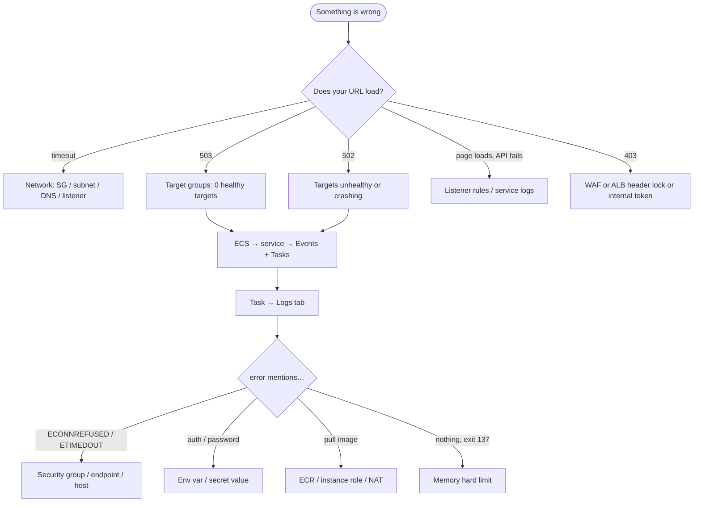

# 10 · Troubleshooting

> 🎯 **Purpose:** symptom → where to look → cause → fix. Ordered from "page doesn't load" down to "one feature is off". Always start from the **outside in**: browser → ALB → target group → task → logs → datastore.

---

## 🔭 The 60-second triage



---

## 1. Local (Docker Compose)

| Symptom | Likely cause | Fix |
|---------|--------------|-----|
| `bind: address already in use` on 5432/27017/6379/8080 | another Postgres/Mongo/Redis/app on your laptop | stop it, or change the **host** side of the port mapping in `docker-compose.yml` (`"15432:5432"`) |
| `cc-auth` restarts 2–3 times then runs | Mongo wasn't ready | normal; `depends_on: condition: service_healthy` keeps it short |
| `cc-product` logs `relation "products" does not exist` | the init SQL didn't run because the `pgdata` volume already existed from an earlier run | `docker compose down -v` (wipes data) → `up -d` |
| Frontend loads but every API call → 502 from nginx | a service is down; nginx can't reach the upstream | `docker compose ps`, `logs <service>` |
| Login says *OTP expired* immediately | clock skew or Redis restarted | request a new OTP |
| `dev_otp` not shown | `DEV_SHOW_OTP` is `false` | read it from `docker compose logs auth-service` |
| Windows: `./scripts/smoke-test.sh` won't run | needs bash + jq | run it from **Git Bash**; `winget install jqlang.jq` |
| Images build but `docker compose up` is very slow | first pull of base images | wait; later runs use the cache |

---

## 2. Network & ALB (Stage 1 steps 1, 2, 8, 9)

| Symptom | Where to look | Cause → fix |
|---------|---------------|-------------|
| Browser **times out** on the ALB DNS | ALB → *Security groups*; *Network mapping* | `cloudcart-alb-sg` missing HTTP from 0.0.0.0/0, or ALB placed in **private** subnets (must be public) |
| **503 Service Temporarily Unavailable** | Target group → *Targets* tab: *0 registered* | no ECS service attached yet, or service failed to start → check ECS |
| **502 Bad Gateway** | Target group → *Targets*: *unhealthy* | 1) health-check path is `/` instead of **`/health`** · 2) `cloudcart-app-sg` doesn't allow **32768-65535 from alb-sg** · 3) the container is crashing (see ECS) |
| Health check **Request timed out** | same | SG rule missing (above), or the task listens on a different port than the target group's *traffic port* |
| Target *healthy* but API returns the **frontend HTML** | ALB → listener rules | path rule missing/typo — `/api/products*` with the `*`; rule priority order |
| `/api/auth/*` works, `/api/products` returns 404 from nginx | rules | the request fell to the **default** rule (frontend) — pattern mismatch |
| Checkout fails with **409 … → 504/timeout** (Stage 1) | order-service logs: `fetch failed … <alb-dns>` | services call each other **through the ALB**; add inbound **HTTP from `cloudcart-app-sg`** to `cloudcart-alb-sg` (Stage 1 Step 2.4) |
| HTTPS works, HTTP shows the old site | HTTP:80 listener still forwards | add the redirect (Stage 2 Step 4.4) |
| HTTPS: *NET::ERR_CERT_COMMON_NAME_INVALID* | ACM cert doesn't cover the hostname | request cert with the exact FQDN or `*.domain` |
| Route 53 record exists, `nslookup` returns nothing | registrar still points at old nameservers | copy the 4 NS values to the registrar; wait up to 24 h |

---

## 3. ECS (Stage 1 steps 7, 11, 12)

| Symptom (Tasks tab / Events) | Cause → fix |
|------------------------------|-------------|
| **No container instances** in cluster; EC2 is running | instance role lacks `AmazonEC2ContainerServiceforEC2Role`, or host has **no internet** (public IP off / wrong subnet / no NAT), or user-data cluster name mismatch (manual launch templates only) → check `/var/log/ecs/ecs-agent.log` via Session Manager |
| Service event: *unable to place a task because no container instance met all of its requirements … insufficient memory* | host memory reserved by other tasks → lower `memoryReservation`, use t3.small+, or set deployment to **0 / 100 %** so the old task stops first |
| `CannotPullContainerError: … pull access denied / 403` | image URI typo (`cloudcart/auth-service` vs `auth-service`), wrong region in URI, or execution role missing `AmazonECSTaskExecutionRolePolicy` |
| `CannotPullContainerError: … i/o timeout` | host can't reach ECR: no public IP / NAT / ECR endpoints |
| `ResourceInitializationError: unable to pull secrets or registry auth` | execution role can't `secretsmanager:GetSecretValue`, wrong secret ARN, or (private subnets) no Secrets Manager endpoint / NAT |
| Task STOPPED, exit code **137**, no error in logs | OOM-killed: `memory` hard limit too low (Node needs ~100 MB+ at start) → raise hard limit |
| Task STOPPED, exit code **1**, logs show `MongoDB connection failed` | bad `MONGODB_URI`, Atlas network access doesn't include host/NAT IP, or special characters in the password not URL-encoded (`@` → `%40`) |
| Logs show `ECONNREFUSED 127.0.0.1:6379` (Stage 1) | `links: ["redis"]` missing or `REDIS_HOST` not `redis`; sidecar not healthy → check `dependsOn` |
| Logs show `getaddrinfo ENOTFOUND redis` (Stage 2) | you removed the sidecar but `REDIS_HOST` still says `redis` → set ElastiCache endpoint |
| Logs: `connect ETIMEDOUT <rds-ip>:5432` | RDS SG isn't `cloudcart-data-sg`, or data-sg lacks 5432 from app-sg, or RDS in a subnet the host can't route to |
| Logs: `password authentication failed for user "postgres"` | `DB_PASSWORD` typo / wrong secret |
| Logs: `database "product_db" does not exist` | Step 10 (create databases) not done |
| Logs: `no pg_hba.conf entry … SSL off` | set `DB_SSL=true` |
| Logs: `self signed certificate in certificate chain` | `DB_SSL=true` sets `rejectUnauthorized:false`; if you changed that, bundle the RDS CA |
| Service stuck *In progress* deployment forever | new task fails health check → ECS keeps retrying; read the **stopped** task's logs, fix, redeploy |
| Session Manager: *not connected* | instance role lacks `AmazonSSMManagedInstanceCore`; private subnet without SSM endpoints/NAT; wait 3 min after boot |
| `docker ps` shows the container restarting every 30 s | ECS container `healthCheck` failing — `wget` not present (non-alpine image) or `/health` returning 503 (dependency down) |

### Reading an ECS task's story
1. **ECS → cluster → Tasks → (filter: Stopped)** → click the task → *Stopped reason* + *Exit code* per container.
2. **Logs** tab (needs the awslogs config to have worked; if the tab is empty and the stop reason is about pulling, it's an image/role/network problem).
3. **Service → Events** tab: the scheduler's own messages (placement, health, draining).
4. On the host (Session Manager): `docker ps -a`, `docker logs <id>`, `sudo tail -50 /var/log/ecs/ecs-agent.log`, `free -m`.

---

## 4. Data layer

| Symptom | Cause → fix |
|---------|-------------|
| RDS creation fails: *subnet group must have subnets in ≥2 AZs* | pick both private subnets |
| RDS *Available* but services can't connect | `Publicly accessible` is irrelevant inside the VPC — check **SG** and **subnet group** |
| ElastiCache endpoint connects from one host, not the other | SG on the cache cluster isn't `cloudcart-data-sg` |
| DocumentDB: `MongoServerSelectionError … TLS` | URI needs `tls=true&tlsCAFile=/app/global-bundle.pem` and the file must be in the image |
| DocumentDB: `retryWrites` error | add `retryWrites=false` to the URI |
| Atlas: `IP not whitelisted` | Network Access must include the host's public IP (Stage 1) or the **NAT EIP** (Stage 2) |
| Product list is stale after an admin edit | Redis cache TTL 60 s (bust happens on write; a second product task may hold old data if sidecars) → Stage 2 shared ElastiCache fixes it |

---

## 5. Auth & permissions

| Symptom | Cause → fix |
|---------|-------------|
| Every API call → **401 Invalid token** after a deploy | `JWT_SECRET` differs between services (one task def not updated / different secret ARN) |
| **403 Admin only** as admin | the JWT was issued before the role changed → logout/login |
| **403 Internal endpoint** in order-service logs | `INTERNAL_SERVICE_TOKEN` mismatch across services |
| OTP email never arrives (Stage 2) | SES sandbox: recipient must be **verified**; check auth-service logs for `SES send failed`; task role lacks `ses:SendEmail` |
| CI/CD: `Not authorized to perform sts:AssumeRoleWithWebIdentity` | trust policy `sub` condition doesn't match `repo:<user>/<repo>:ref:refs/heads/main`, or variables in GitHub are wrong |
| CI/CD: ECR push `denied` | role lacks `AmazonEC2ContainerRegistryPowerUser` or repo names differ |
| `ecs:UpdateService … AccessDenied` | inline policy resource ARN must be `service/cloudcart-cluster/*` |

---

## 6. Edge (Stage 3)

| Symptom | Cause → fix |
|---------|-------------|
| CloudFront: *502* but ALB works directly | origin protocol HTTPS but ALB has no valid cert for the ALB DNS → set origin to **HTTP** *or* use the custom domain as origin with the cert |
| CloudFront caches API responses (stale cart) | `/api/*` behavior must use **CachingDisabled** |
| `Authorization` header stripped → all API 401 | origin request policy must forward headers (**AllViewerExceptHostHeader**) |
| POST returns 403 *Missing Authentication Token*-style | allowed methods only GET/HEAD → include POST/PUT/DELETE |
| WAF blocks the admin's product description (contains `<b>`) | Common rule set XSS false positive → add a rule exception or sanitise input |
| Direct ALB returns 200 (should be 403) | header-check rule order; the "no header → 403" rule must be the **last** rule before default |

---

## 7. Useful commands (via Session Manager on an ECS host)

```bash
# Is the ECS agent happy?
sudo systemctl status ecs; curl -s localhost:51678/v1/metadata | jq .

# Containers & their host ports (what the target group sees)
docker ps --format 'table {{.Names}}\t{{.Status}}\t{{.Ports}}'

# Hit a service directly on its dynamic port
curl -s localhost:32769/health

# Can the host reach RDS / Redis / Atlas?
nc -zv cloudcart-postgres.xxxx.us-east-1.rds.amazonaws.com 5432
nc -zv cloudcart-redis.xxxx.cache.amazonaws.com 6379
curl -sI https://cloud.mongodb.com | head -1

# Memory headroom (why tasks won't place)
free -m; docker stats --no-stream

# ECS agent log (why a task was refused)
sudo tail -50 /var/log/ecs/ecs-agent.log
```

> Still stuck? Describe the symptom, paste the **stopped reason**, the **last 20 log lines**, and the **target health reason** — those three almost always identify it.
