# 11 · ECS Task Definition — the complete field-by-field guide

> 🎯 **Purpose:** the task definition is where your whole Docker configuration lives in AWS — image, ports, memory, env vars, secrets, logs, health checks. This doc walks the **Create task definition** screen top-to-bottom in the exact order the console shows it, says what every field does, what happens if you get it wrong, what you must create *before* you can fill it, and exactly what to type for each of the six CloudCart tasks.
>
> The screenshots are from a real, working EC2-backed task (`tsrs-auth-backend-prod`). CloudCart uses the same pattern, so you can compare screen-for-screen.

---

## 0. 🧠 The mental model (read this first)

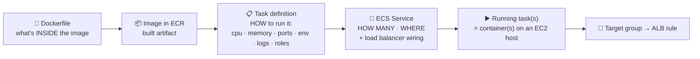

| Thing | Local equivalent | Changes when… |
|---|---|---|
| **Image** | `docker build` | code changes → new push |
| **Task definition** | the `services:` block in `docker-compose.yml` (image, ports, environment, logging, depends_on) | config changes → **new revision** (immutable; revision 1, 2, 3…) |
| **Service** | `docker compose up` + `restart: always` + `scale` | desired count / which revision to run |
| **Task** | one running container (or a group of containers that share a host) | — |

> **Immutable means:** you can't *edit* a task definition. Every change = *Create new revision*, then *Update service → new revision*. Old revisions stay forever (useful for rollback) until you deregister them.

### What must exist before you open this screen

| Prerequisite | Why the form needs it | Where it's created |
|---|---|---|
| ECR repository **with an image pushed** | *Image URI* field; a task with no image goes STOPPED instantly | Stage 1 Step 4 |
| `cloudcart-ecs-task-execution-role` | *Task execution role* dropdown | Stage 1 Step 3.2 |
| CloudWatch log group (or let ECS auto-create it) | *Logging → awslogs-group* | Stage 1 Step 6 |
| Endpoints/passwords for RDS, Atlas, ALB DNS | *Environment variables* values | Stage 1 Steps 5, 0.4, 9 |
| (Stage 2) Secrets in Secrets Manager + permission on the execution role | *Environment variables → ValueFrom* | Stage 2 Step 3 |
| (optional) a task role, e.g. `cloudcart-auth-task-role` for SES | *Task role* dropdown | Stage 2 Step 8 |

The cluster, ALB and target groups are **not** needed to *create* a task definition — only to create the *service* that runs it.

---

## 1. Task definition configuration

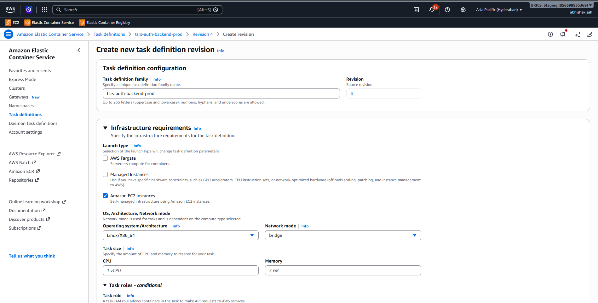

| Field | What it is | Impact if wrong | CloudCart value |
|---|---|---|---|
| **Task definition family** | The *name* of this blueprint. Revisions are numbered inside the family (`cc-auth:1`, `cc-auth:2`…). | Typo = a brand-new family and your service won't see the revision | `cc-frontend`, `cc-auth`, `cc-product`, `cc-cart`, `cc-order`, `cc-payment` |
| **Revision / Source revision** | Read-only. When you *Create new revision* it copies the chosen source revision so you only change what's different. | — | starts at 1 |

> 💡 **Naming tip:** keep family = ECS service name (`cc-auth` both). The CI/CD scripts and your own memory depend on it. In the TSRS screenshot the family (`tsrs-auth-backend-prod`) carries env + purpose — good practice for multi-environment accounts.

---

## 2. Infrastructure requirements

| Field | Options | What it means | CloudCart choice & why |
|---|---|---|---|
| **Launch type** | AWS Fargate / Managed Instances / **Amazon EC2 instances** | Which kind of compute this task is *allowed* to run on. You may tick more than one. | ✅ **Amazon EC2 instances only**. Ticking Fargate too forces `awsvpc` + fixed CPU/memory and removes `bridge`. |
| **Operating system / Architecture** | Linux/X86_64, Linux/ARM64, Windows… | Must match the CPU type of (a) the image you built and (b) the EC2 host. | **Linux/X86_64** (our images are built on x86 laptops; t3 hosts are x86). Switch to ARM64 only if you move to t4g hosts *and* build multi-arch images. |
| **Network mode** | awsvpc / **bridge** / host / none | How the container gets a network. | **bridge** — the container shares the host's network stack through Docker's virtual bridge; the host port can be **0 = dynamic**, so many copies of one service fit on one host. `awsvpc` gives each task its own ENI/IP (needed for Fargate; limited ENIs per EC2 size). `host` binds container port = host port directly (fast, but only one copy per host). |
| **Task size — CPU / Memory** | numbers or blank | *Task-level* ceiling across all containers. **Optional for EC2 + bridge.** Mandatory for Fargate. | **Leave blank** on EC2. We set limits per container instead (section 5). If set, it becomes the hard reservation ECS must find free on a host — too high and tasks won't place. |

> 🧠 **bridge + hostPort 0 is the whole trick** that lets a 2 GB t3.small run nine containers behind one ALB. The target group type must be **Instances** (ECS registers `host-ip:random-port`), never *IP addresses*.

---

## 3. Task roles — conditional

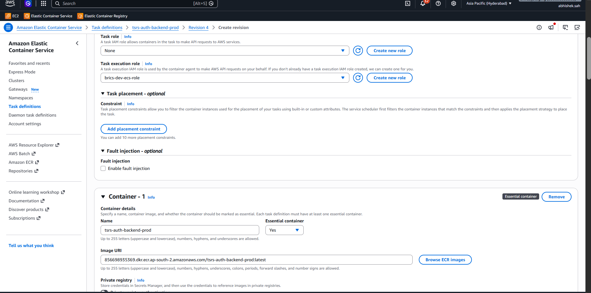

| Field | Who uses it | Needed when | CloudCart value |
|---|---|---|---|
| **Task role** | **Your application code** inside the container, via the AWS SDK (ECS injects temporary credentials). | The code calls an AWS API: SES, S3, SQS, Rekognition… The TSRS role screenshot (`brics-dev-ecs-role` with S3/SQS/SNS/Rekognition/EFS inline policies) is a *task-role* style role being reused as execution role too — works, but over-broad. | **None** in Stage 1. Stage 2: `cc-auth` → `cloudcart-auth-task-role` (SES only). Others stay None. |
| **Task execution role** | **The ECS agent**, *before* your code runs: pull the image from ECR, create the log stream, fetch secrets. | Always, on EC2 when using ECR + awslogs. | `cloudcart-ecs-task-execution-role` |

Symptoms: wrong/missing **execution** role → `CannotPullContainerError` / `ResourceInitializationError: unable to pull secrets`. Missing **task** role → your code logs `AccessDeniedException` / `CredentialsProviderError`.

> ⚠️ Don't click *Create new role* here for the execution role — it makes a generic `ecsTaskExecutionRole`. Use the named one so the ledger and IAM doc stay accurate.

### Task placement — optional
Constraints like `attribute:ecs.availability-zone == us-east-1a` or `memberOf(attribute:instance-type =~ t3.*)`. **Leave empty.** Placement *strategy* (spread/binpack) is set on the *service*, not here (Stage 3 Step 2).

### Fault injection — optional
Lets you run chaos experiments (kill, latency) against this task via the ECS fault-injection endpoints. **Unticked.** A Stage 3 game-day toy.

---

## 4. Container – 1 · Container details

| Field | What it is | Impact | CloudCart value |
|---|---|---|---|
| **Name** | Name of this container *inside the task*. Used by `links`, `dependsOn`, the service's "container to load balance" picker, and `docker ps` on the host. | Must be unique in the task | `frontend` / `auth` / `product` / `cart` / `order` / `payment` (+ `redis` for sidecars) |
| **Essential container** | Yes = if this container dies, the whole task is stopped and restarted by the service. No = the task keeps running without it. | A non-essential app container that crashes leaves a "running" task that serves nothing | **Yes** for app containers **and** for the Redis sidecars (if Redis dies, auth/cart are useless anyway). |
| **Image URI** | `<account>.dkr.ecr.<region>.amazonaws.com/<repo>:<tag>` from ECR. Must be the **same region** as the cluster unless you add cross-region pull permissions. | Typo/region mismatch → `CannotPullContainerError`. `:latest` works but is a moving target — the service re-pulls only on a new deployment. | `856698935369.dkr.ecr.us-east-1.amazonaws.com/cloudcart/auth-service:latest` (Stage 2: `:<git-sha>` tags) |
| **Browse ECR images** | picker that fills the URI | — | use it to avoid typos |
| **Private registry authentication** | Only for Docker Hub/GHCR private images; needs a Secrets Manager secret with username/password | Off for ECR (IAM handles ECR) | **Off** |

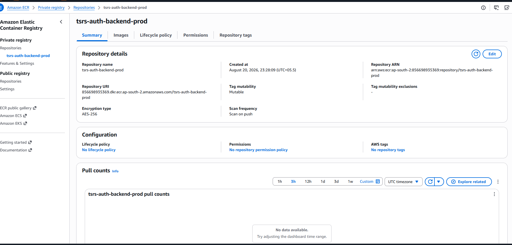

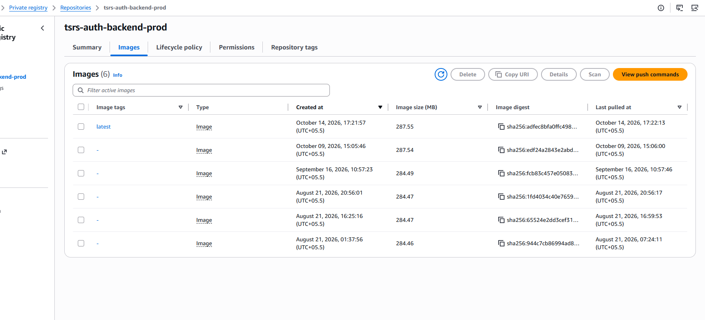

> 🧠 **About that images list:** six images, only one tagged `latest`, the rest `-`. Every push with the same tag *moves* the tag and leaves the old image untagged. Untagged images still cost storage and clutter rollback. Add an **ECR lifecycle policy** (*expire untagged after 1 day, keep last 10 tagged*) — Stage 2 Step 10. Also note *Scan on push* and *Tag mutability: Mutable* on the summary — fine for a demo; prod uses immutable tags.

---

## 5. Port mappings, read-only FS, resource limits

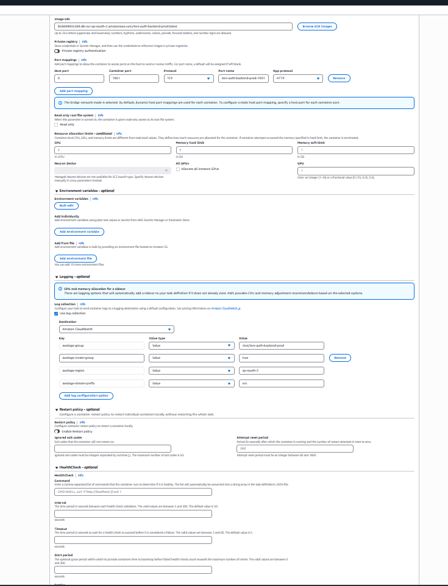

### Port mappings

| Field | Meaning | CloudCart value |
|---|---|---|
| **Host port** | Port opened on the EC2 host. **`0` = dynamic** (ECS picks one in 32768-65535 and tells the target group). | **0** |
| **Container port** | Port your app listens on inside the container (`PORT` env / `EXPOSE`). | 80 / 5001 / 5002 / 5003 / 5004 / 5005 |
| **Protocol** | TCP / UDP | TCP |
| **Port name** | Label used by **Service Connect** (Stage 2) to advertise this port as `product-service:5002`. | auto-generated is fine (e.g. `product-5002-tcp`) |
| **App protocol** | HTTP / HTTP2 / gRPC — gives Service Connect per-request metrics (5xx, latency) | **HTTP** |

The blue banner you see ("bridge network mode selected, dynamic host port…") is the console confirming host port 0 is the default. **If you type a fixed host port (e.g. 5001)** only one copy of that task can run per host, and a second deployment fails with *port already in use*.

### Read-only root file system
Container can't write anywhere except mounted volumes/tmpfs. Good hardening (Stage 3). CloudCart services write only to stdout, so it *could* be on — but nginx needs `/var/cache/nginx` and `/var/run` writable, so for the frontend you'd add tmpfs mounts first. **Off in Stage 1.**

### Resource allocation limits (container-level) — the fields that decide cost and stability

| Field | Meaning | Too low | Too high |
|---|---|---|---|
| **CPU** (vCPU) | Share of CPU *weight* (1 vCPU = 1024 units). On EC2 it's a relative share, not a cap, unless the host is saturated. | app is slow under load | tasks don't place (scheduler reserves it) |
| **Memory hard limit** (GB) | `docker --memory`. Container is **OOM-killed (exit 137)** if it exceeds this. | random restarts, exit 137 in task stopped reason | host memory "used up" on paper → *insufficient memory* placement errors |
| **Memory soft limit** (GB) | `memoryReservation`. What the scheduler *reserves* on the host; the container may use up to the hard limit if free. | — | same placement problem |

> The TSRS task uses **1 vCPU / 1 GiB hard**, which is generous for a Node service and limits how many tasks fit on one host. For CloudCart on a **t3.small (2 vCPU / 2 GiB)**:

| Task | CPU | Soft (reservation) | Hard (OOM kill) | Notes |
|---|---|---|---|---|
| frontend (nginx) | 0.125 | 64 MB | 128 MB | nginx uses ~10 MB |
| auth | 0.25 | 192 MB | 384 MB | mongoose + aws-sdk |
| product | 0.25 | 192 MB | 384 MB | |
| cart | 0.125 | 128 MB | 256 MB | |
| order | 0.25 | 192 MB | 384 MB | |
| payment | 0.125 | 128 MB | 256 MB | |
| redis sidecar ×3 | 0.03 | 64 MB | 128 MB | |
| **Total reserved** | ~1.2 vCPU | **~1.1 GB** | — | fits 2 GiB with ECS agent headroom |

Rule of thumb: **soft ≈ steady-state usage × 1.5, hard ≈ soft × 2**. Measure after a day with Container Insights and tighten.

**Neuron device / GPU** — only for ML accelerators (inf/trn/g instances). Leave blank.

---

## 6. Environment variables — optional (the most error-prone section)

| Sub-field | Meaning |
|---|---|
| **Key** | The variable name your code reads (`process.env.DB_HOST`). Exact, case-sensitive. |
| **Value type: Value** | Plain text, visible to anyone who can read the task definition (console, `describe-task-definition`). |
| **Value type: ValueFrom** | ARN of a **Secrets Manager** secret or **SSM Parameter**; the execution role fetches it at start-up and injects the *value*. Never visible in the console. Stage 2. |
| **Add from file** | Bulk load an `.env`-style file from **S3** (`arn:aws:s3:::bucket/cloudcart/auth.env`). Needs `s3:GetObject` on the execution role. Handy for 15+ vars; we use a handful, so skip. |

Per-service variable lists are in **[03-lld.md §2](03-lld.md#2--environment-variables-copy-these-into-task-definitions)**; the ready-to-paste JSON is in `aws/task-definitions/`.

**The three mistakes everyone makes**
1. **Trailing space or quotes** in a value → `password authentication failed`. The console doesn't trim.
2. `REDIS_HOST=redis` still set after removing the sidecar (Stage 2) → `ENOTFOUND redis`.
3. `JWT_SECRET` different in one task → every call to that service returns **401**.

> 🧠 Compare with `docker-compose.yml`: the `environment:` block of each service *is* this section. `<<: *common-env` (JWT + internal token) becomes the two variables you must copy into all five.

---

## 7. Logging — optional (never actually optional)

| Field | Meaning | CloudCart value |
|---|---|---|
| **Use log collection** | ticked = container stdout/stderr goes somewhere; unticked = logs vanish when the container stops | ✅ **ticked** |
| **Destination** | Amazon CloudWatch (awslogs driver) / Splunk / Kinesis Firehose (FireLens) | **Amazon CloudWatch** |
| `awslogs-group` | log group name | `/ecs/cloudcart/auth` etc. |
| `awslogs-create-group` | `true` = ECS creates the group if missing (needs `logs:CreateLogGroup` on the execution role — the managed policy has it) | `true` (or pre-create in Step 6 and set retention) |
| `awslogs-region` | **must equal the cluster's region** | `us-east-1` |
| `awslogs-stream-prefix` | stream name = `prefix/container-name/task-id` | `ecs` |

⚠️ If `awslogs-region` is wrong (e.g. left as `ap-south-2` when the cluster is in `us-east-1`) the task fails with *"CannotStartContainerError: … failed to initialize logging driver"*. This is the #1 copy-paste error between regions.

Set **retention** on the group (1 week for demo) — auto-created groups default to *Never expire*.

---

## 8. Restart policy — optional
Restarts just the container locally (max N times) instead of ECS replacing the whole task. Useful for sidecars. **Off** for CloudCart — the service already replaces failed tasks, and the Dockerfile `HEALTHCHECK` + container health check (next) handle the rest.

---

## 9. HealthCheck — optional (recommended)

| Field | Value | Why |
|---|---|---|
| **Command** | `CMD-SHELL, wget -qO- http://127.0.0.1:5001/health \|\| exit 1` | Alpine images have `wget`, not `curl`. Use the right port per service. |
| **Interval** | 30 | seconds between checks |
| **Timeout** | 5 | |
| **Start period** | 30 | grace period while Node connects to DBs; failures in this window don't count |
| **Retries** | 3 | 3 consecutive failures → UNHEALTHY → service replaces the task |

This is the **container** health check (Docker-level), separate from the **target group** health check (ALB-level, path `/health`). Both are good: the ALB one stops traffic, the container one triggers replacement. In your TSRS task the health status shows **Unknown** because this section was left blank — the task runs fine, but ECS can't tell a hung process from a healthy one.

---

## 10. Startup dependency ordering · Container timeouts

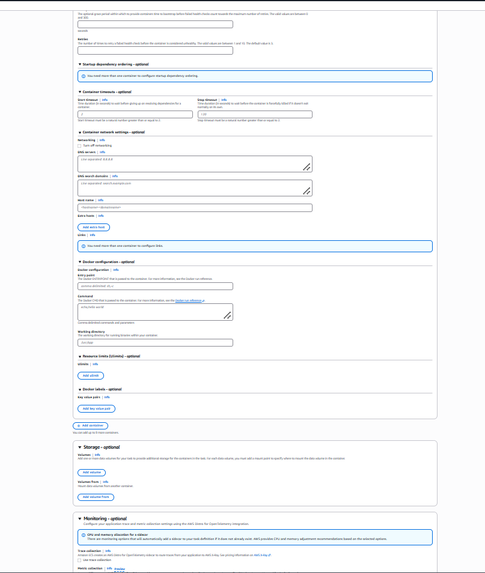

| Field | Meaning | CloudCart |
|---|---|---|
| **Startup dependency ordering** | Only with ≥2 containers: *app* depends on *redis* with condition **HEALTHY** (requires the redis container to have a health check), START, COMPLETE or SUCCESS. | `cc-auth`, `cc-product`, `cc-cart` (Stage 1): `auth` dependsOn `redis` HEALTHY |
| **Start timeout** | Seconds to wait for dependencies before giving up (default 120 on EC2 via agent config) | leave default |
| **Stop timeout** | Seconds between SIGTERM and SIGKILL on stop. Node servers finish in-flight requests in this window. | 30 (default) — our services don't hold long requests |

---

## 11. Container network settings — optional

| Field | Meaning | CloudCart |
|---|---|---|
| **Turn off networking** | container has no network at all | never |
| **DNS servers / search domains** | override `/etc/resolv.conf` | blank — VPC DNS is fine |
| **Host name** | container's hostname | blank |
| **Extra hosts** | `/etc/hosts` entries | blank |
| **Links** | bridge-mode-only alias to another container in the *same task*: `redis` → app can reach `redis:6379` | **`redis`** on auth/product/cart in Stage 1; removed in Stage 2 |

---

## 12. Docker configuration — optional (⚠️ leave blank)

| Field | Meaning | Danger |
|---|---|---|
| **Entry point** | overrides `ENTRYPOINT` in the Dockerfile | |
| **Command** | overrides `CMD` (`node server.js`) | typing `echo,hello world` here means your server never starts and the task exits 0 immediately — a "successful" crash loop |
| **Working directory** | overrides `WORKDIR` | wrong dir → `Cannot find module server.js` |

The Dockerfile already has the right values. **Leave all three empty.** Only use them for one-off tasks like a DB migration (`Command: node,scripts/migrate.js`) — that's a legitimate pattern for Stage 2 (run `init.sql` via a one-off task instead of Session Manager).

### Resource limits (ulimits) · Docker labels
`nofile` (open files) etc. and metadata labels. Blank.

---

## 13. Storage — optional

| Field | Meaning | CloudCart |
|---|---|---|
| **Volumes → Add volume** | Bind mount (host path), Docker volume, or **EFS** (Stage 3 Step 5) | none |
| **Volumes from** | share another container's volumes | none |

All CloudCart state lives in RDS/Mongo/Redis; containers are disposable. That's the design goal — if you ever "need" a volume on an app container, question the design first.

---

## 14. Monitoring — optional

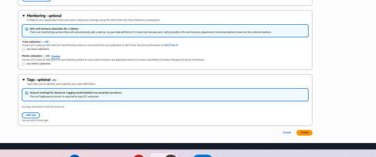

| Field | Meaning | Cost | CloudCart |
|---|---|---|---|
| **Use trace collection** | adds an **AWS Distro for OpenTelemetry sidecar** that ships traces to X-Ray | sidecar memory + X-Ray per trace | off (Stage 3 nice-to-have) |
| **Use metric collection** | same sidecar sends custom app metrics to CloudWatch/Prometheus | per metric | off |

Note the blue banner: ticking either **silently adds a container** to your task definition and adjusts memory. That's why memory suddenly "doesn't fit" after enabling monitoring.

---

## 15. Tags — optional (not optional for us)

Add `Project` = `cloudcart` on every task definition. The banner mentions *Resource Tagging Authorization* — your account setting is on, meaning the `ecs:TagResource` permission is required to tag; your admin user has it.

Click **Create** → revision 1 is registered.

---

## 16. After Create — how it all connects (your TSRS example annotated)

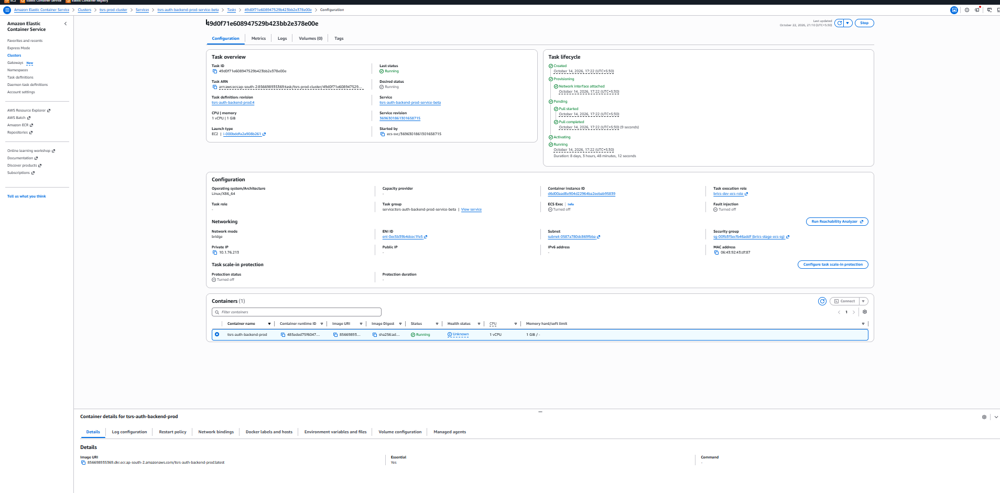

Read a running task top-down:
- **Task definition: revision** `…:4` — which blueprint it was launched from.
- **Launch type EC2**, **Container instance ID** — which host it landed on.
- **Network mode bridge**, **Private IP 10.x** = the *host's* IP (bridge mode has no per-task IP), **Public IP —** (private subnet ✅).
- **Security group** `brics-stage-ecs-sg` = the *host's* SG.
- **Health status: Unknown** → no container health check configured (section 9).
- **ECS Exec: Turned off** → see section 17.
- **Containers → Network bindings** tab shows `5001 → host:32791` — exactly what the target group registers.

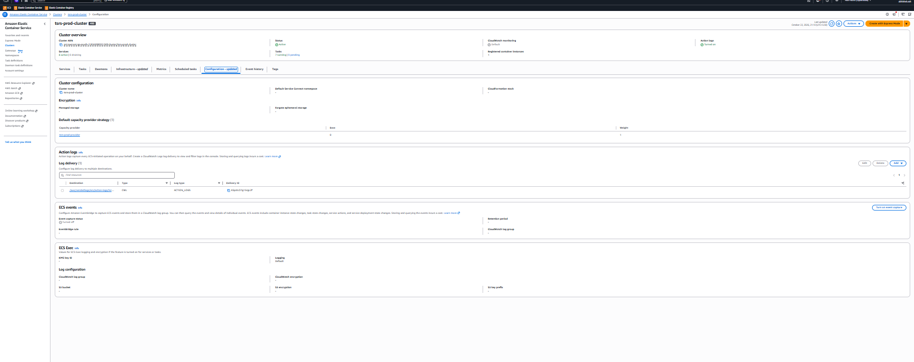

The cluster uses a **capacity provider** (`tsrs-prod-provider`, base 0 weight 1) — the Stage 2 pattern where the ASG grows when tasks don't fit. **Container Insights: Default** (off) keeps cost low; **Action logs** on is useful.

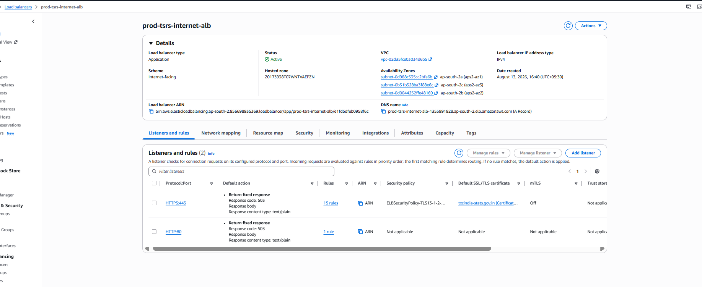

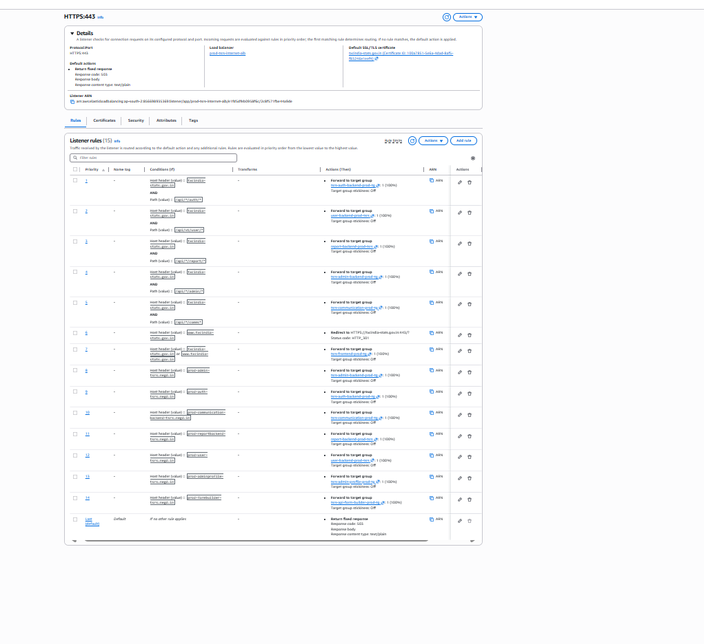

The ALB is the production shape you'll reach in Stage 2: **HTTPS:443** with an ACM cert, **HTTP:80** returning 503 (rather than redirecting — a redirect is friendlier), and 15 rules combining **Host header AND Path** conditions. CloudCart Stage 1 needs only *Path* rules; add Host-header conditions when you serve several subdomains from one ALB. Rule 6 (`www.` → 301 to apex) is a nice touch to copy.

---

## 17. Turning on **ECS Exec** (shell into a running container, no SSH)

ECS Exec lets you run `docker exec`-style commands inside a task through SSM — the container equivalent of Session Manager. It shows *Turned off* on your task because three things must line up:

| # | Requirement | How |
|---|---|---|
| 1 | **Task role** with SSM permissions | Create `cloudcart-ecs-exec-task-role` (trust: `ecs-tasks.amazonaws.com`) with inline policy: `ssmmessages:CreateControlChannel`, `ssmmessages:CreateDataChannel`, `ssmmessages:OpenControlChannel`, `ssmmessages:OpenDataChannel` on `*`. Attach as **Task role** in the task definition (new revision). If a service already has a task role (e.g. auth/SES), add the four actions to that role instead. |
| 2 | **Service has `enableExecuteCommand`** | The console: **Service → Update → (expand) *Configure service connect / Other* → ✅ *Turn on ECS Exec*** (field name varies by console version; in older consoles it is only available via CLI). CLI: `aws ecs update-service --cluster cloudcart-cluster --service cc-auth --enable-execute-command --force-new-deployment`. The flag applies to **new** tasks, hence the redeploy. |
| 3 | **Host / network can reach SSM** | ECS-optimized AMI ≥ 2021 has the SSM agent; the host needs internet or the three SSM VPC endpoints (Stage 2 Step 1.3). The *instance* role needs `AmazonSSMManagedInstanceCore` (already there). |

Then from your laptop (AWS CLI + [Session Manager plugin](https://docs.aws.amazon.com/systems-manager/latest/userguide/session-manager-working-with-install-plugin.html) installed):

```bash
aws ecs execute-command --cluster cloudcart-cluster --task <task-id> \
  --container auth --interactive --command "/bin/sh"
```

Verify: task → *Configuration* shows **ECS Exec: Turned on**, and *Managed agents* tab lists `ExecuteCommandAgent: RUNNING`. The **Connect** button on the task page (visible in your screenshot) becomes active.

> 🧠 Why bother when Session Manager on the host + `docker exec` works? ECS Exec is per-task, audited in CloudTrail, works on Fargate too, and doesn't require host access — it's the production-grade way and the only option once hosts are managed instances.

---

## 18. ✅ Checklist — the fields that bite (print this)

| ✅ Must get right | ❌ Common mistake | Symptom |
|---|---|---|
| Launch type **EC2 only** | Fargate also ticked | bridge mode disappears; CPU/memory become mandatory |
| Network mode **bridge** | awsvpc on a small EC2 | "ENI limit reached", only 2-3 tasks per t3.small |
| Host port **0** | fixed host port | second task/deploy fails *port in use* |
| Image URI **same region**, correct repo path | `ap-south-2` URI with `us-east-1` cluster | `CannotPullContainerError` |
| **Execution role** = `cloudcart-ecs-task-execution-role` | None / generic role lacking Secrets permission | pull/secret errors |
| **Task role** only when code calls AWS | execution role reused as task role (over-privileged) | works, but a compromised container can touch S3/SQS… |
| Memory **soft < hard**, totals fit the host | 1 GiB per task on a 2 GiB host | *insufficient memory* placement failures |
| Env vars exact, no trailing spaces, `JWT_SECRET` identical everywhere | copy-paste with quotes | 401s, DB auth failures |
| `awslogs-region` = cluster region | copied from another region | *failed to initialize logging driver* |
| Health check command uses **wget** and the right port | `curl` on Alpine | always UNHEALTHY → restart loop |
| Docker **Command/Entry point blank** | sample text left in | task exits 0 immediately |
| `links: redis` + dependsOn HEALTHY for sidecar tasks (Stage 1) | forgot links | `ECONNREFUSED 127.0.0.1:6379` |
| Tag `Project=cloudcart` | no tag | missed at teardown |

| 💸 Cost levers in this screen | Cheap choice |
|---|---|
| CPU / memory reservations | size from measurement; smaller reservations = more tasks per host = fewer hosts |
| Monitoring sidecars (trace/metric) | off until you need them |
| Log retention (set on the group) | 7 days demo / 30 prod |
| Image size (Dockerfile) | alpine base, `--omit=dev`, `.dockerignore` → faster pulls, less ECR |
| Launch type | EC2 with right-sized hosts is cheaper than Fargate for always-on tasks |

---

## 19. 🔧 Debugging a task definition — the sequence

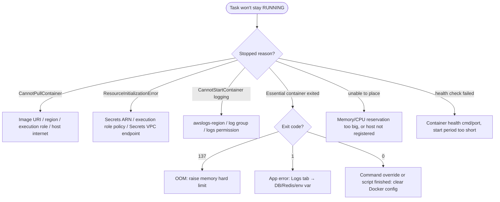

**Where to look, in order:** ECS → Tasks (filter *Stopped*) → task → *Stopped reason* → *Logs* tab → *Containers → exit code* → service *Events* tab → host `docker ps -a` / `/var/log/ecs/ecs-agent.log` via Session Manager. Full table in [10-troubleshooting.md §3](10-troubleshooting.md#3-ecs-stage-1-steps-7-11-12).

**Rolling back:** service → Update → *Revision* dropdown → pick the previous number → Update. Two minutes.

---

## 20. 📄 Mapping to the CloudCart JSON templates

Everything above is already encoded in `aws/task-definitions/cc-*.json`. The JSON key for each console field:

| Console field | JSON key |
|---|---|
| Family | `family` |
| Launch type | `requiresCompatibilities: ["EC2"]` |
| Network mode | `networkMode: "bridge"` |
| Execution / task role | `executionRoleArn` / `taskRoleArn` |
| Container name / image / essential | `containerDefinitions[].name` / `image` / `essential` |
| Port mapping | `portMappings[{containerPort, hostPort: 0, protocol}]` |
| CPU / soft / hard | `cpu` (units, 1024 = 1 vCPU) / `memoryReservation` / `memory` (MiB) |
| Env vars (Value / ValueFrom) | `environment[{name,value}]` / `secrets[{name,valueFrom}]` |
| Logging | `logConfiguration.logDriver: "awslogs"` + `options` |
| Health check | `healthCheck{command,interval,timeout,retries,startPeriod}` |
| Links / dependency | `links` / `dependsOn[{containerName,condition}]` |
| Tags | `tags[{key,value}]` |

Console first (to learn every field once), JSON afterwards (to never mistype it again). That is the right order — and after you've done it six times for CloudCart, Terraform/CDK will read like a summary of this page.
