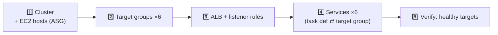

# 12 · ECS Cluster, Target Groups, ALB & Service — field-by-field

> 🎯 **Purpose:** doc 11 explained *how one container runs*. This one explains *where it runs and how traffic reaches it*: the four console screens you fill after the task definition, in the order you must create them. Every field, what it does, what to type for CloudCart, what breaks if you skip it.

**Order matters:** the service screen needs an existing task definition (doc 11), cluster, ALB and target group to pick from its dropdowns.

---

## 1️⃣ Cluster — *ECS → Clusters → Create cluster*

### 1.1 Cluster configuration
| Field | Meaning | CloudCart |
|---|---|---|
| **Cluster name** | logical group of hosts + services. One per environment is normal (`tsrs-prod-cluster` in your account). | `cloudcart-cluster` |
| **Default namespace** (Service Connect) | Cloud Map namespace used when services turn on Service Connect | blank now; `cloudcart.local` in Stage 2 Step 5 |

### 1.2 Infrastructure
| Field | Options & meaning | CloudCart |
|---|---|---|
| **AWS Fargate** | serverless capacity provider; always offered | ❌ untick |
| **Amazon EC2 instances** | you supply hosts via an Auto Scaling group | ✅ |
| **Auto Scaling group** | *Create new* lets the console build the launch template + ASG; *Use existing* if you built one by hand | **Create new** |
| **Provisioning model** | On-demand / Spot. Spot ≈ 70 % cheaper but can be reclaimed with 2-min notice | On-demand (Stage 1); Spot as a 2nd provider in Stage 3 |
| **Container instance AMI** | ECS-optimized AMI family (AL2023 recommended; AL2 legacy; Bottlerocket minimal). The AMI has Docker + ECS agent + SSM agent preinstalled | **Amazon Linux 2023** |
| **EC2 instance type** | host size. Memory is the binding constraint on ECS | **t3.small** (2 vCPU / 2 GiB). t3.micro (1 GiB) can't hold six services |
| **EC2 instance role** | instance profile; must allow ECS agent + SSM | `cloudcart-ecs-instance-role` |
| **Desired / Min / Max capacity** | ASG size. ECS "managed scaling" on the capacity provider moves *desired* between min and max | 1 / 1 / 1 (Stage 1) → 1 / 1 / 3 (Stage 2) |
| **SSH key pair** | only if you plan to SSH | **None** (Session Manager) |
| **Root EBS volume size** | disk for images + container layers | 30 GiB |

### 1.3 Network settings for EC2 instances
| Field | Meaning | Stage 1 | Stage 2 |
|---|---|---|---|
| **VPC** | | `cloudcart-vpc` | same |
| **Subnets** | where hosts launch; pick ≥2 AZs for HA | the 2 **public** subnets | the 2 **private** subnets |
| **Security group** | the host SG — this is what the ALB and the DBs reference | `cloudcart-app-sg` | same |
| **Auto-assign public IP** | hosts get an internet-routable IP | **On** (no NAT yet) | **Off** |

### 1.4 Monitoring · Encryption · Tags
| Field | CloudCart |
|---|---|
| **Container Insights** | off (Stage 1) → *Enhanced* in Stage 2 (per-task metrics, costs per metric) |
| **Managed storage encryption** | default (Fargate-only field) |
| **Tags** | `Project=cloudcart` |

**What Create actually makes:** a CloudFormation stack (you'll see `Infra-ECS-Cluster-cloudcart-cluster-…` under CloudFormation) containing a launch template, an ASG, and a **capacity provider** named like the ASG, already attached to the cluster with the default strategy *base 0 / weight 1* — exactly what your TSRS screenshot shows under *Default capacity provider strategy*.

### Capacity provider — what it is
Links the cluster to the ASG and lets ECS **scale the hosts**: when a task can't be placed, managed scaling raises the ASG desired count; when hosts sit empty, it lowers it (to *min*). **Target capacity 100 %** = "keep hosts just full". *Base* = how many tasks always go to this provider, *weight* = ratio when several providers exist (e.g. 1 on-demand : 3 spot). **Managed termination protection** stops the ASG from killing a host that still runs tasks.

### ✅ Verify
Cluster → *Infrastructure* tab → **Container instances: 1**, *Agent connected: true*, Registered CPU/memory shows ~2048 units / ~1900 MiB available. EC2 → instance → Connect → **Session Manager** works.

---

## 2️⃣ Target groups — *EC2 → Target groups → Create* (×6)

A target group is a **list of host:port pairs plus a health check**. The ALB forwards to the group; ECS keeps the list up to date as tasks start/stop.

| Field | Meaning | CloudCart |
|---|---|---|
| **Target type** | *Instances* (host:port — needed for bridge/dynamic ports) · *IP addresses* (awsvpc/Fargate) · *Lambda* · *ALB* | **Instances** |
| **Target group name** | ≤32 chars, hyphens only | `cc-tg-frontend`, `cc-tg-auth`, `cc-tg-product`, `cc-tg-cart`, `cc-tg-order`, `cc-tg-payment` |
| **Protocol : Port** | the *default* port; ECS overrides per target with the dynamic host port, so this value only matters for manual registration | HTTP : 80 / 5001 / 5002 / 5003 / 5004 / 5005 |
| **IP address type** | IPv4 | IPv4 |
| **VPC** | must be the hosts' VPC | `cloudcart-vpc` |
| **Protocol version** | HTTP1 / HTTP2 / gRPC between ALB and target | HTTP1 |
| **Health check protocol / path** | ALB calls this on every target every *interval* seconds | HTTP / **`/health`** |
| **Port** (advanced) | *Traffic port* = the dynamic port; *Override* = fixed | **Traffic port** |
| **Healthy / Unhealthy threshold** | consecutive successes/failures to flip state | 2 / 3 |
| **Timeout / Interval** | per check | 5 s / 15 s (faster feedback while learning; 30 s default is fine in prod) |
| **Success codes** | HTTP codes counted healthy | 200 (use `200-299` if a service redirects) |
| **Register targets** page | manual registration | **register nothing** — ECS does it |

Attributes worth knowing (edit after creation): **Deregistration delay** (default 300 s — how long a stopping task keeps receiving in-flight requests; set **30** for faster deploys in a demo), **Stickiness** (off; our JWT makes sessions stateless), **Slow start** (ramp traffic to new targets; off).

> ⚠️ Health-check path `/` works for the frontend but returns 404 on the API services → *unhealthy* → 502. **Always `/health`.**

### ✅ Verify
Six groups, each *0 targets*, "no load balancer associated" (expected until step 4).

---

## 3️⃣ Application Load Balancer — *EC2 → Load balancers → Create → ALB*

| Section | Field | Meaning | CloudCart |
|---|---|---|---|
| Basic | **Name** | | `cloudcart-alb` |
| | **Scheme** | *Internet-facing* (public IPs, in public subnets) vs *Internal* (private only, e.g. between microservices) | **Internet-facing** |
| | **IP address type** | IPv4 / dualstack | IPv4 |
| Network mapping | **VPC** | | `cloudcart-vpc` |
| | **Mappings** | ≥2 AZs required; pick the **public** subnet in each. (Your TSRS ALB spans 3 AZs — fine, slightly more LCU-resilient) | 2 public subnets |
| Security groups | | the ALB's own firewall | `cloudcart-alb-sg` only; remove `default` |
| Listeners and routing | **Protocol:Port** | a listener = "what port the ALB accepts on" + default action | HTTP:80 → forward `cc-tg-frontend` (Stage 1); add HTTPS:443 in Stage 2 |
| Secure listener settings | security policy, ACM cert | only for HTTPS | Stage 2 |
| Attributes (post-create) | deletion protection, access logs, idle timeout (60 s), HTTP/2, drop invalid headers | demo: leave defaults; prod: deletion protection on, access logs to S3 | |
| Tags | | `Project=cloudcart` | |

### Listener rules — *ALB → Listeners → HTTP:80 → Manage rules*
Each rule = **conditions (IF)** + **action (THEN)** + **priority**. Lower number wins; the *default* rule catches everything else.

| Condition type | Use |
|---|---|
| **Path** | `/api/products*` — what CloudCart uses in Stage 1 |
| **Host header** | `prod-auth.tsrs.negd.in` — route several subdomains on one ALB (your TSRS rules 8-14); CloudCart doesn't need it until it has subdomains |
| Host AND Path | TSRS rules 1-5: same host, split by path — this is also how you'd host *two projects* on one ALB |
| HTTP header / method / query / source IP | advanced (API keys, A/B, geo-block) |

| Action | Use |
|---|---|
| **Forward to target group** (optionally weighted: 90/10 canary) | normal |
| **Redirect** | HTTP→HTTPS 301; `www.` → apex (TSRS rule 6) |
| **Fixed response** | 503 "maintenance" or 403 for blocked paths (`/internal/*`) |
| Authenticate (Cognito/OIDC) | put login in front of an admin UI |

CloudCart rules (priority order): `/api/auth*`→auth · `/api/products*`→product · `/api/cart*`→cart · `/api/orders*`→order · `/api/payments*`→payment · default→frontend. Patterns are **case-sensitive**, `*` = any chars, `?` = one char.

> 🧠 Your TSRS HTTP:80 default is a **fixed 503** — safe, but a user typing `http://` gets an error. CloudCart Stage 2 uses **Redirect to HTTPS 301** instead.

### ✅ Verify
State *Active*; `http://<dns-name>` → **503** (no targets yet — correct). A *timeout* means the ALB SG or subnets are wrong.

---

## 4️⃣ Service — *Cluster → Services → Create* (×6)

A service is the controller that keeps *N* copies of a task definition running and registers them in a target group.

### 4.1 Environment
| Field | Meaning | CloudCart |
|---|---|---|
| **Compute options** | *Capacity provider strategy* (use the cluster's providers — enables managed host scaling) vs *Launch type* (just "run on EC2") | **Launch type → EC2** in Stage 1 (simplest); switch to **Capacity provider strategy** in Stage 2 Step 6 so hosts auto-scale |
| **Platform version** | Fargate only | — |

### 4.2 Deployment configuration
| Field | Meaning | CloudCart |
|---|---|---|
| **Application type** | *Service* (long-running) vs *Task* (run once, e.g. a migration) | Service |
| **Task definition family / Revision** | which blueprint; *LATEST* follows new revisions only when you click Update | `cc-auth` / latest |
| **Service name** | | **same as family** (`cc-auth`) — the CI/CD scripts call `update-service --service cc-$svc` |
| **Service type** | *Replica* (N copies anywhere) vs *Daemon* (exactly one per host — log/metrics agents) | Replica |
| **Desired tasks** | copies to keep running | 1 |
| **Availability Zone rebalancing** | moves tasks to balance AZs after a host returns | on (harmless) |
| **Deployment controller** | *ECS rolling* vs *CodeDeploy blue/green* (Stage 3 stretch) vs external | ECS |
| **Min running / Max running %** | during a deploy, how many tasks may be below/above desired. **200 %** means "start the new one before stopping the old" (needs spare memory) | **0 / 100** on a single t3.small; **100 / 200** once you have 2 hosts |
| **Deployment failure detection** | *circuit breaker* (auto-stop a deploy whose tasks keep failing) + *rollback* | ✅ both on — saves you from watching a crash loop |
| **CloudWatch alarms** | abort a deploy if an alarm fires | Stage 2 (`cc-alb-5xx`) |

### 4.3 Service Connect — optional
Turns on the Envoy sidecar so tasks reach each other as `product-service:5002`. **Off in Stage 1** (services call via ALB DNS); **Client and server** in Stage 2 Step 5 with the port name from the task definition.

### 4.4 Service discovery — optional
Older Cloud Map DNS-based discovery. **Off** — Service Connect replaces it.

### 4.5 Networking
In **bridge** mode on EC2 this section is **disabled** — the task inherits the host's subnet and SG (that's why your TSRS task shows the host's `brics-stage-ecs-sg`). With awsvpc/Fargate you'd pick subnets + SG here per task.

### 4.6 Load balancing
| Field | Meaning | CloudCart |
|---|---|---|
| **Load balancer type** | ALB / NLB / none | **Application Load Balancer** |
| **Container** | which container:port in the task receives traffic (shows `auth 5001:0`) | the app container, not `redis` |
| **Use an existing load balancer** | | `cloudcart-alb` |
| **Health check grace period** | seconds ECS ignores ALB health failures after a task starts (Node + DB connect needs ~30 s) | **60** |
| **Listener** | *Use existing* HTTP:80 | existing |
| **Target group** | *Use existing* | `cc-tg-auth` (matching one) |

> 🧠 This is the single screen that **connects task ⇄ target group ⇄ ALB rule**. If the ALB rule points at `cc-tg-auth` but the service registers into `cc-tg-product`, you'll see healthy targets and still get the wrong service. Match the three names every time.

### 4.7 Service auto scaling — optional
| Field | Meaning | CloudCart |
|---|---|---|
| **Min / Max tasks** | bounds | 1 / 3 (Stage 2) |
| **Policy: Target tracking** | keep a metric at a target (CPU 60 %, or *ALBRequestCountPerTarget* 500) — simplest, recommended | CPU 60 % |
| **Step scaling** | add N tasks when alarm breaches thresholds — finer control | later |
| **Cooldowns** | scale-out 60 s, scale-in 300 s | defaults |

### 4.8 Task placement (EC2 only)
Strategy templates: **AZ balanced spread** (default: spread AZ, then binpack memory — best for cost+HA), *Binpack* (pack tightest), *One task per host* (daemon-like), *Custom*. Keep **AZ balanced spread**.

### 4.9 Volumes · Tags
Volumes: only if the task definition declares EBS/EFS volumes. Tags: `Project=cloudcart`; tick **ECS managed tags** + **propagate tags from task definition** so tasks inherit it.

**Create** → *Deployments* tab shows *In progress* → *Completed* in 2-4 minutes.

### ✅ Verify (the chain)
1. Service → **Tasks**: 1 RUNNING, *Health status* HEALTHY (if container health check set).
2. Task → **Containers → Network bindings**: `5001 → <host-ip>:3xxxx`.
3. EC2 → Target groups → `cc-tg-auth` → **Targets**: that same host:port, **healthy**. Unhealthy → check SG `app-sg` allows 32768-65535 from `alb-sg`, and path `/health`.
4. `curl http://<alb-dns>/api/auth/health` → JSON.
5. Service → **Events**: "has reached a steady state".

---

## 5️⃣ Day-2 operations on a service

| I want to… | Where | Note |
|---|---|---|
| Deploy a new image (same tag) | Service → Update → ✅ **Force new deployment** | re-pulls `:latest`; or `aws ecs update-service --force-new-deployment` (what CI/CD does) |
| Deploy a new revision | Service → Update → Revision → LATEST | |
| Roll back | Service → Update → Revision → previous number | ~2 min |
| Scale by hand | Service → Update → Desired tasks | 0 pauses the service (no cost but ALB 503) |
| Stop a stuck deployment | Service → Deployments → *Stop* (with circuit breaker it rolls back itself) | |
| See why a task died | Service → Tasks → filter *Stopped* → *Stopped reason* + Logs | doc 11 §19 |
| Enable ECS Exec | Service → Update → **Turn on ECS Exec** + task role with ssmmessages | doc 11 §17 |
| Change deploy % | Service → Update → Deployment options | |
| Delete a service | set desired 0 → Delete (or *Force delete*) | removes targets from the TG automatically |

---

## 6️⃣ ✅ Checklist — fields that bite

| ✅ Must | ❌ Mistake | Symptom |
|---|---|---|
| Cluster hosts in **app-sg**, right subnets, public IP on (Stage 1) | hosts in private subnet without NAT | 0 registered container instances |
| Target type **Instances** | IP addresses | service creation error: *target type mismatch* |
| Health path **/health** | `/` | 502, targets unhealthy |
| ALB in **public** subnets, **alb-sg** only | private subnets / default SG | timeout |
| Listener rule patterns with `*`, priority ordered | `/api/products` without `*` | sub-paths hit the default (frontend HTML) |
| Service name = task family | different names | CI/CD `update-service` fails |
| Container picker = app container, matching target group | `redis` chosen / wrong TG | healthy targets but wrong responses |
| Min/Max **0/100** on one small host | 100/200 | deploy stuck: *insufficient memory* |
| Circuit breaker + rollback **on** | off | crash loops run forever, burning deploy time |
| Health-check grace **60 s** | 0 | tasks killed before Node connects to DB |
| `alb-sg` inbound HTTP from `app-sg` (Stage 1) | missing | checkout 409/504 (service-to-service via ALB fails) |
| Tags everywhere | — | teardown misses resources |

| 💸 Cost levers | Cheap choice |
|---|---|
| Host type & count | t3.small ×1; capacity provider min 1 max 3 only after load testing |
| Container Insights | off until Stage 2 |
| ALB count | **one** ALB for all services (and even multiple projects, via host-header rules) — each ALB is ₹48/day |
| Deregistration delay | 30 s (faster deploys, no cost effect but less waiting) |
| Spot capacity provider | Stage 3 for burst hosts |

➡️ Back to [04 · Stage 1](04-aws-stage1-mvp.md) to execute these in order, or [11 · Task definition](11-task-definition-deep-dive.md) for the container side.
